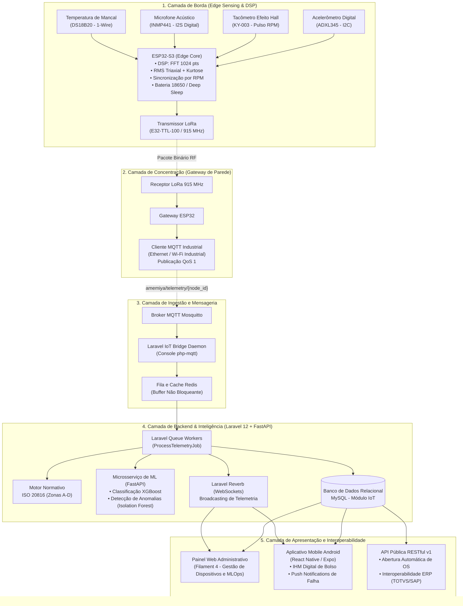
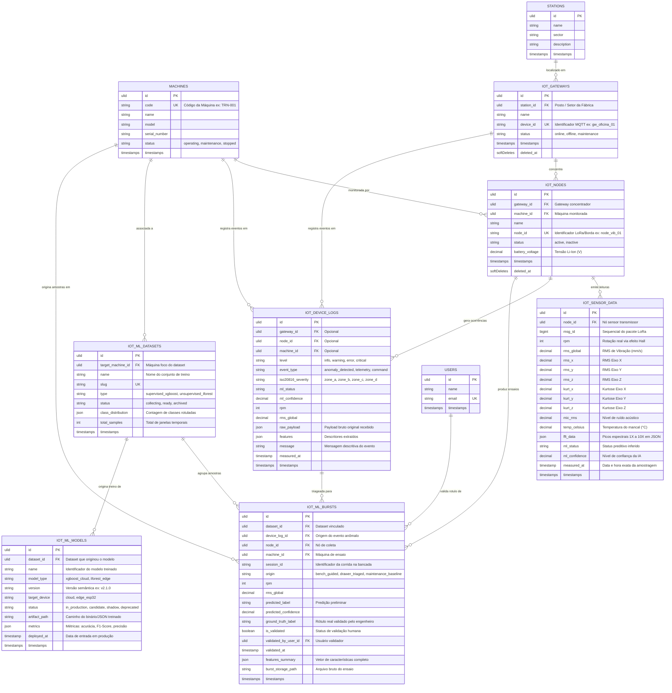

# Arquitetura de Software e Modelo de Banco de Dados — Subsistema IoT
**Projeto Integrador: Engenharia de Computação — 5º Semestre (SENAC)**  
**Empresa Parceira:** Metalúrgica Amemiya  
**Escopo:** Subsistema de Monitoramento Preditivo e IoT 4.0 (Exclusivo)  
**Data:** Outubro / 2026  

---

## 1. Visão Geral do Sistema IoT

O subsistema de IoT da plataforma **Amemiya** foi desenvolvido para monitorar a integridade mecânica de máquinas operatrizes (tornos mecânicos, fresadoras e centros de usinagem CNC). A solução coleta grandezas físicas críticas (**vibração triaxial, rotação real por efeito Hall, ruído acústico e temperatura de contato dos mancais**), processa descritores estatísticos e espectrais na borda (*Edge Computing*), transmite os pacotes via rádio de longo alcance (*LoRa*) e orquestra a classificação preditiva de falhas em tempo real (*XGBoost* e norma *ISO 20816*).

---

## 2. Arquitetura de Software em Camadas

A arquitetura adota o padrão de microsserviços e mensageria assíncrona orientada a eventos (*Event-Driven Architecture*), estruturada em 5 camadas lógicas:

### 2.1 Detalhamento das Camadas

1. **Camada de Borda (Edge Sensing & DSP):**
   * **Microcontrolador:** ESP32-S3 operando em extrabaixa tensão, energizado por células Li-Ion 18650 com rotinas de *Deep Sleep*.
   * **Sensing:** 
     * **ADXL345:** Aceleração triaxial em faixa de ±16g, amostragem a 3,2 kHz.
     * **KY-003:** Sensor de efeito Hall para captura dos pulsos de passagem do ímã no eixo, fornecendo a velocidade angular instantânea (RPM).
     * **INMP441:** Microfone MEMS com barramento digital I2S de 24 bits para assinatura acústica de atrito e cavitação.
     * **DS18B20:** Sensor de temperatura 1-Wire com contato térmico direto na carcaça do mancal.
   * **Processamento Local (DSP):** Cálculo da FFT síncrona (Análise de Ordem normalizada por RPM), extração de descritores no tempo (RMS, Kurtose, Fator de Crista) e empacotamento compacto.
   * **Enlace:** Rádio LoRa (915 MHz) via módulo E32-TTL-100 com alcance de centenas de metros sem depender da rede Wi-Fi da fábrica.

2. **Camada de Concentração (Gateway):**
   * Dispositivo concentrador fixado à parede da oficina mecânica, alimentado por fonte DC industrial.
   * Recebe os pacotes LoRa dos nós e publica via MQTT com política de confirmação *QoS 1* no tópico estruturado `amemiya/telemetry/{node_id}`.

3. **Camada de Ingestão e Mensageria:**
   * **Broker Mosquitto:** Gerencia as filas de publicação e subscrição.
   * **Laravel MQTT Bridge:** Daemon em PHP (`php artisan iot:mqtt-bridge`) executando de forma contínua em container Docker.
   * **Redis Buffer:** Armazena payloads transitórios em memória para absorver picos de rajadas de telemetria sem bloquear conexões de banco de dados.

4. **Camada de Backend & MLOps:**
   * **Workers Assíncronos:** Processam as mensagens da fila Redis via `ProcessTelemetryJob`.
   * **Avaliação Normativa (ISO 20816):** Classifica a severidade da vibração mecânica em Zonas de Operação (Zona A: Nova; Zona B: Operação irrestrita; Zona C: Alerta de manutenção; Zona D: Parada mandatória).
   * **Microsserviço de ML:** Servidor Python FastAPI que executa inferência através do modelo supervisionado **XGBoost** (rotulando estados de: *Saudável*, *Desbalanceamento*, *Desalinhamento*, *Folga Mecânica* ou *Falha de Rolamento*).
   * **Laravel Reverb:** Servidor WebSockets nativo que despacha eventos `SensorDataReceived` e `AnomalyDetected` aos clientes conectados com latência inferior a 200 ms.

5. **Camada de Apresentação e Interoperabilidade:**
   * **Painel Web (Filament 4):** Painel de controle para engenharia e calibração de modelos MLOps.
   * **App Mobile Android (React Native):** Terminal de bolso para os mecânicos e operadores de chão de fábrica, com recebimento de notificações *Push* de falha iminente.
   * **API Pública RESTful v1:** Endpoints padronizados com autenticação via token Bearer (Sanctum) para acionamento de sistemas corporativos externos (ERP/CMMS).

---

## 3. Modelo de Banco de Dados Relacional (Módulo IoT)

O modelo de dados foi estruturado no banco de dados **MySQL** utilizando identificadores únicos universais (**ULID**) como chaves primárias, garantindo ordenação cronológica estrita e alta performance de escrita.

### 3.1 Diagrama Entidade-Relacionamento (DER)

---

## 4. Dicionário de Dados Detalhado (Tabelas do Módulo IoT)

### 4.1 Tabela: `iot_gateways`
Armazena os dispositivos concentradores de rádio LoRa instalados nas paredes da oficina.
* `id` (`CHAR(26)`, PK): Identificador universal ordenável (ULID).
* `station_id` (`CHAR(26)`, FK, Nullable): Posto ou setor da oficina onde o concentrador está posicionado.
* `name` (`VARCHAR(255)`): Nome amigável de identificação do concentrador.
* `device_id` (`VARCHAR(255)`, UK): Identificador único transmitido nos tópicos MQTT (ex: `gw_oficina_01`).
* `status` (`ENUM('online', 'offline', 'maintenance')`): Estado operacional do gateway.
* `created_at`, `updated_at`, `deleted_at`: Controle temporal e exclusão lógica (*soft deletes*).

### 4.2 Tabela: `iot_nodes`
Armazena os nós inteligentes fixados nos motores das máquinas operatrizes.
* `id` (`CHAR(26)`, PK): Identificador universal (ULID).
* `gateway_id` (`CHAR(26)`, FK): Concentrador responsável por receber o sinal LoRa do nó.
* `machine_id` (`CHAR(26)`, FK): Máquina operatriz monitorada pelo dispositivo.
* `name` (`VARCHAR(255)`): Nome amigável do nó sensor.
* `node_id` (`VARCHAR(255)`, UK): Código único de hardware do nó (ex: `node_vib_torno_01`).
* `status` (`ENUM('active', 'inactive')`): Status de operação.
* `battery_voltage` (`DECIMAL(4,2)`): Nível de carga do pack de baterias Li-Ion 18650 em Volts.
* `created_at`, `updated_at`, `deleted_at`: Controle temporal e *soft deletes*.

### 4.3 Tabela: `iot_sensor_data`
Tabela analítica de séries temporais de alta densidade que registra cada pacote de telemetria processado.
* `id` (`CHAR(26)`, PK): Identificador universal (ULID).
* `node_id` (`CHAR(26)`, FK): Nó emissor da leitura.
* `msg_id` (`BIGINT`): Contador sequencial de pacotes para rastreamento de perda de sinal de rádio.
* `rpm` (`INT`): Rotação por minuto real da máquina medida pelo sensor de efeito Hall KY-003.
* `rms_global` (`DECIMAL(10,4)`): Valor eficaz de velocidade de vibração em mm/s (ponderação triaxial).
* `rms_x`, `rms_y`, `rms_z` (`DECIMAL(10,4)`): Velocidade RMS individual em cada eixo cartesiano.
* `kurt_x`, `kurt_y`, `kurt_z` (`DECIMAL(10,4)`): Kurtose estatística para detecção de impactos de rolamento.
* `mic_rms` (`DECIMAL(10,4)`): Nível de pressão sonora capturado pelo microfone MEMS digital INMP441.
* `temp_celsius` (`DECIMAL(6,2)`): Temperatura da carcaça do mancal lida pela sonda DS18B20 em °C.
* `fft_data` (`JSON`): Vetor contendo amplitudes dos harmônicos de rotação (1X, 2X, 3X, 4X RPM e ruído de fundo).
* `ml_status` (`VARCHAR(50)`): Diagnóstico de falha gerado pelo modelo na borda.
* `ml_confidence` (`DECIMAL(5,4)`): Probabilidade calculada pela IA (0,0000 a 1,0000).
* `measured_at` (`TIMESTAMP`): Carimbo de tempo preciso da medição.
* **Índices de Performance:** Índice composto em `[node_id, measured_at]` para consultas temporais sub-segundo.

### 4.4 Tabela: `iot_device_logs`
Tabela de eventos operacionais, alertas normativos e histórico de anomalias.
* `id` (`CHAR(26)`, PK): Identificador universal (ULID).
* `gateway_id` (`CHAR(26)`, FK, Nullable), `node_id` (`CHAR(26)`, FK, Nullable), `machine_id` (`CHAR(26)`, FK, Nullable).
* `level` (`ENUM('info', 'warning', 'error', 'critical')`): Gravidade do evento registrado.
* `event_type` (`VARCHAR(50)`): Categoria (`anomaly_detected`, `telemetry_received`, `command_dispatched`).
* `iso20816_severity` (`ENUM('zone_a', 'zone_b', 'zone_c', 'zone_d')`): Enquadramento na norma de vibração mecânica ISO 20816.
* `ml_status` (`VARCHAR(50)`), `ml_confidence` (`DECIMAL(5,4)`), `rpm` (`INT`), `rms_global` (`DECIMAL(10,4)`).
* `raw_payload` (`JSON`): Cópia exata do payload de telemetria recebido para fins de auditoria.
* `features` (`JSON`): Vetor de variáveis numéricas extraídas.
* `message` (`VARCHAR(255)`): Descrição textual legível do alerta disparado.
* `measured_at` (`TIMESTAMP`): Momento da ocorrência física.

### 4.5 Tabela: `iot_ml_datasets`
Catálogo de conjuntos de dados para treinamento e avaliação dos modelos de Inteligência Artificial.
* `id` (`CHAR(26)`, PK): Identificador universal (ULID).
* `target_machine_id` (`CHAR(26)`, FK, Nullable): Máquina ou bancada experimental de onde os dados derivam.
* `name` (`VARCHAR(255)`): Nome do dataset (ex: `dataset_bancada_desbalanceamento_v2`).
* `slug` (`VARCHAR(255)`, UK): Identificador amigável em URLs.
* `type` (`ENUM('supervised_xgboost', 'unsupervised_iforest')`): Paradigma de modelagem.
* `status` (`ENUM('collecting', 'ready', 'archived')`): Ciclo de vida do dataset.
* `class_distribution` (`JSON`): Contagem de amostras por classe (ex: `{"saudavel": 240, "desalinhamento": 180}`).
* `total_samples` (`INT UNSIGNED`): Quantidade total de janelas de medição catalogadas.

### 4.6 Tabela: `iot_ml_bursts`
Amostras específicas de janelas temporais de falha rotuladas (*ground truth*) usadas para treinar o algoritmo preditivo.
* `id` (`CHAR(26)`, PK): Identificador universal (ULID).
* `dataset_id` (`CHAR(26)`, FK): Dataset ao qual a amostra pertence.
* `device_log_id` (`CHAR(26)`, FK, Nullable): Evento anômalo original que originou o registro.
* `node_id` (`CHAR(26)`, FK), `machine_id` (`CHAR(26)`, FK).
* `session_id` (`VARCHAR(255)`): Código da bateria de testes/ensaio mecânico na bancada de testes.
* `origin` (`ENUM('bench_guided', 'drawer_triaged', 'maintenance_baseline')`): Origem da coleta.
* `rpm` (`INT`), `rms_global` (`DECIMAL(10,4)`).
* `predicted_label` (`VARCHAR(50)`): Rótulo sugerido pelo modelo.
* `predicted_confidence` (`DECIMAL(5,4)`): Confiança da predição.
* `ground_truth_label` (`VARCHAR(50)`): Rótulo real atestado pelo especialista de engenharia (*saudável, desbalanceamento, folga, rolamento*).
* `is_validated` (`BOOLEAN`): Indicador de aprovação por auditor humano.
* `validated_by_user_id` (`CHAR(26)`, FK, Nullable): Usuário que realizou a rotulação manual.
* `validated_at` (`TIMESTAMP`, Nullable): Momento da aprovação.
* `features_summary` (`JSON`): Vetor numérico normalizado pronto para alimentar o treinamento.
* `burst_storage_path` (`VARCHAR(255)`): Caminho do arquivo bruto com as amostras temporais.

### 4.7 Tabela: `iot_ml_models`
Repositório de modelos treinados para governança e versionamento (*MLOps*).
* `id` (`CHAR(26)`, PK): Identificador universal (ULID).
* `dataset_id` (`CHAR(26)`, FK, Nullable): Dataset utilizado para treinar o modelo.
* `name` (`VARCHAR(255)`): Nome descritivo da versão (ex: `xgb_vibracao_amemiya_prod`).
* `model_type` (`ENUM('xgboost_cloud', 'iforest_edge')`): Algoritmo de classificação.
* `version` (`VARCHAR(50)`): Versão semântica (ex: `v2.0.0`).
* `target_device` (`ENUM('cloud', 'edge_esp32')`): Destino de execução do artefato.
* `status` (`ENUM('in_production', 'candidate', 'shadow', 'deprecated')`): Estado de governança no pipeline.
* `artifact_path` (`VARCHAR(255)`): Caminho de armazenamento do arquivo do modelo (`.json` ou cabeçalho C++ `.h`).
* `metrics` (`JSON`): Métricas de validação computadas (Acurácia, F1-Score, Matriz de Confusão).
* `deployed_at` (`TIMESTAMP`, Nullable): Data e hora de publicação oficial em produção.

---

## 5. Estratégias de Desempenho e Confiabilidade

1. **Desacoplamento Assíncrono com Redis:**
   O tráfego MQTT não grava diretamente no MySQL. O daemon insere os payloads brutos em uma lista em memória no Redis (`LPUSH`). Workers assíncronos do Laravel processam as inserções em blocos consolidados (*bulk insert*), garantindo tolerância a falhas e eliminando contenção de escrita no disco.
2. **Consultas Temporais Otimizadas:**
   A tabela `iot_sensor_data` utiliza índices compostos por `[node_id, measured_at]`. Isso viabiliza que o aplicativo mobile e o painel web renderizem curvas de tendência de vibração e FFT de períodos de 24 horas em menos de 80 ms.
3. **Persistência de Espectro FFT em JSON Nativo:**
   A extração espectral (picos de amplitude nas frequências 1X, 2X e 3X da rotação) é serializada como documento JSON nativo do MySQL, permitindo tanto a recuperação direta para renderização gráfica quanto a indexação de atributos específicos sem exigir dezenas de colunas esparsas.
