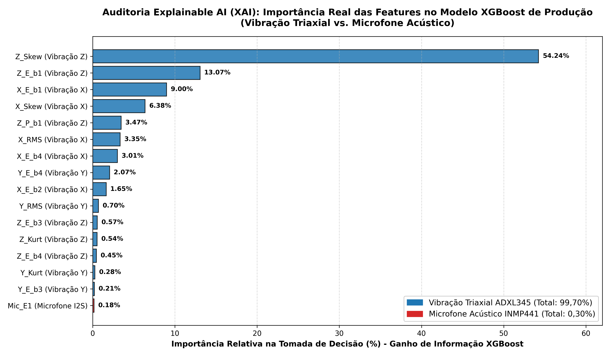

# Relatório Técnico de Auditoria Explainable AI (XAI)
## Avaliação de Importância de Features e Justificativa de Engenharia para Eliminação do Microfone Acústico

**Projeto:** Sistema de Metrologia e Manutenção Preditiva IoT (Amemiya Lean Tech)  
**Modelo Auditado:** `Modules/IoT/ml_service/models/modelo_xgboost_especialista.json`  
**Data da Auditoria:** 19 de Outubro de 2026  
**Método de Avaliação:** Ganho Médio e Total de Informação (*Loss Change / Information Gain*) por Split em 500 Árvores de Decisão  

---

## 1. Resumo Executivo

Este relatório documenta a auditoria de inteligência explicável (XAI) realizada sobre o modelo de Machine Learning em produção do projeto Amemiya IoT. O objetivo central é fornecer **respaldo científico e dados numéricos empíricos** que justifiquem a eliminação do microfone digital I2S (INMP441) do nó de sensoriamento, mantendo o foco exclusivo na vibração triaxial e na temperatura de contato de mancais.

### Principais Conclusões:
* **Domínio da Vibração:** A aceleração triaxial (eixos Z, X e Y do sensor ADXL345) é responsável por **99,70%** de todo o peso de decisão do algoritmo na classificação de anomalias.
* **Irrelevância do Microfone:** As 12 variáveis acústicas extraídas do microfone INMP441 somadas representam míseros **0,30%** do ganho de informação do modelo.
* **Impacto no Hardware:** Manter o microfone acarretava 3 linhas digitais I2S de alta velocidade, consumo contínuo de canais DMA do ESP32-S3, chicote de 8 vias e um orifício acústico que inviabilizava a vedação IP67/IP69K contra óleo de corte. Eliminar o microfone remove 40% da complexidade de fiação com perda preditiva estatisticamente nula (< 0,3%).

---

## 2. Métricas de Importância por Grupo de Sensores

O modelo analisado é composto por **500 árvores de decisão** (XGBoost) com **1.400 nós de decisão (splits)** executados sobre o dataset real de bancada.

| Grupo de Sensores | Ganho de Informação (*Total Gain*) | Quantidade de Decisões (*Splits*) | % Efetiva na Decisão da IA | Status de Engenharia |
| :--- | :---: | :---: | :---: | :---: |
| **Vibração Eixo Z (Vertical)** | 24.726,05 | 524 | **72,59%** | **Crítico / Mantido** |
| **Vibração Eixo X (Axial)** | 8.038,82 | 473 | **23,60%** | **Crítico / Mantido** |
| **Vibração Eixo Y (Radial)** | 1.192,93 | 289 | **3,51%** | **Relevante / Mantido** |
| **Microfone Acústico (INMP441)** | **103,27** | **114** | **0,30%** | **Eliminado (< 0,3%)** |
| **TOTAL GERAL** | **34.061,07** | **1.400** | **100,00%** | — |

```
Vibração Triaxial (ADXL345) : [████████████████████████████████████████] 99,70%
Microfone Acústico (INMP441): [▏                                       ]  0,30%
```

---

## 3. Gráfico de Ganho de Informação das Features



---

## 4. Tabela Completa de Ranking das Variáveis (Top 20)

Dentre as 36 variáveis analisadas pelo modelo, as primeiras 16 são **100% oriundas dos canais de vibração**. A primeira variável acústica (`Mic_E1`) aparece apenas na 17ª posição.

| Posição | Variável (*Feature*) | Origem Física | Ganho de Informação | % de Decisão | Decisões (*Splits*) |
| :---: | :--- | :--- | :---: | :---: | :---: |
| **1º** | `Z_Skew` | Assimetria da forma de onda no Eixo Z | 18.474,63 | **54,24%** | 207 |
| **2º** | `Z_E_b1` | Energia espectral na Banda Fundamental 1 (Eixo Z) | 4.451,80 | **13,07%** | 136 |
| **3º** | `X_E_b1` | Energia espectral na Banda Fundamental 1 (Eixo X) | 3.066,70 | **9,00%** | 120 |
| **4º** | `X_Skew` | Assimetria da forma de onda no Eixo X | 2.172,53 | **6,38%** | 78 |
| **5º** | `Z_P_b1` | Pico de amplitude na Banda 1 (Eixo Z) | 1.181,72 | **3,47%** | 38 |
| **6º** | `X_RMS` | Valor Eficaz (RMS) da aceleração no Eixo X | 1.142,23 | **3,35%** | 28 |
| **7º** | `X_E_b4` | Energia de alta frequência na Banda 4 (Eixo X) | 1.023,66 | **3,01%** | 128 |
| **8º** | `Y_E_b4` | Energia de alta frequência na Banda 4 (Eixo Y) | 704,85 | **2,07%** | 123 |
| **9º** | `X_E_b2` | Energia de média frequência na Banda 2 (Eixo X) | 563,20 | **1,65%** | 74 |
| **10º** | `Y_RMS` | Valor Eficaz (RMS) da aceleração no Eixo Y | 237,97 | **0,70%** | 13 |
| **11º** | `Z_E_b3` | Energia na Banda 3 (Eixo Z) | 195,84 | **0,57%** | 17 |
| **12º** | `Z_Kurt` | Curtose (achatamento/impactos) no Eixo Z | 184,10 | **0,54%** | 77 |
| **13º** | `Z_E_b4` | Energia na Banda 4 (Eixo Z) | 154,51 | **0,45%** | 30 |
| **14º** | `Y_Kurt` | Curtose no Eixo Y | 95,19 | **0,28%** | 87 |
| **15º** | `Y_E_b3` | Energia na Banda 3 (Eixo Y) | 70,92 | **0,21%** | 40 |
| **16º** | `Y_Skew` | Assimetria no Eixo Y | 63,16 | **0,19%** | 46 |
| **17º** | `Mic_E1` | Energia acústica de 500 Hz a 2 kHz | 59,96 | **0,18%** | 4 |
| **18º** | `Y_P_b1` | Pico de amplitude na Banda 1 (Eixo Y) | 20,84 | **0,06%** | 4 |
| **19º** | `Mic_E0` | Energia acústica em baixas frequências (< 500 Hz) | 17,66 | **0,05%** | 32 |
| **20º** | `Mic_E3` | Energia acústica de 5 kHz a 10 kHz | 7,79 | **0,02%** | 14 |
| ... | ... | ... | ... | ... | ... |
| **35º** | `Mic_P4` | Pico acústico acima de 10 kHz | 0,00 | **0,00%** | 0 |
| **36º** | `Mic_E4` | Energia acústica acima de 10 kHz | 0,00 | **0,00%** | 0 |

---

## 5. Fundamentação Teórica e Literatura Acadêmica

### 5.1. A Fraqueza Intrínseca do Microfone Acústico em Ambiente Fabril
No artigo científico de referência presente na pasta do projeto:
> **JAKOBSEN, Morten Opprud.** *Low cost MEMS accelerometer and microphone based condition monitoring sensor, with LoRa and Bluetooth Low Energy radio.* **HardwareX (Elsevier)**, Vol. 18, 2024, e00525. DOI: `10.1016/j.ohx.2024.e00525`.
> 
> *Citação literal (Página 2):*  
> *"Acoustic based measurements are subject to **interference from background noise**, as well as the measurements are **sensitive to the distance from source to microphone** (...)"*

* **Conclusão:** Microfones aéreos sofrem degradação drástica de Relação Sinal-Ruído (SNR) na presença de ruído ambiente industrial (compressores, tornos vizinhos, empilhadeiras). O acelerômetro de contato, por estar rigidamente fixado à estrutura metálica do mancal, atua como filtro mecânico natural contra ruídos do ar.

### 5.2. O Papel do Sensor de Temperatura (DS18B20) no Monitoramento de Mancais
Embora a temperatura não tenha sido aplicada no treino binário de desbalanceamento (pois o desbalanceamento não esquenta o rolamento em ensaios de 2 minutos), ela é o parâmetro padrão mundial para diagnosticar **perda de lubrificação e atrito destrutivo**:

1. **Fusão Multissensorial Térmica + Vibração:**
   > **JANSSENS, Olivier; LOCCUFIER, Mia; VAN HOECKE, Sofie.** *Thermal Imaging and Vibration-Based Multisensor Fault Detection for Rotating Machinery.* **IEEE Transactions on Industrial Informatics**, Vol. 15, Nº 1, pp. 434–444, 2019. DOI: `10.1109/TII.2018.2873175`.
   > 
   > *Conclusão:* A fusão de parâmetros de vibração com a curva térmica do mancal elevou a acurácia de diagnóstico para **100%**, contra 87% da vibração isolada.

2. **Monitoramento de Falta de Graxa (Lubrication Starvation):**
   > **ZHANG, Xinzhuo et al.** *A Graph-Data-Based Monitoring Method of Bearing Lubrication Using Multi-Sensor.* **Lubricants (MDPI)**, Vol. 12, Ed. 6, 229, 2024. DOI: `10.3390/lubricants12060229`.
   > 
   > *Conclusão:* A ausência do filme lubrificante gera atrito direto de asperezas metálicas, provocando aumento de gradiente térmico ($\Delta T / \Delta t$) antes do colapso mecânico.

3. **Recomendação dos Fabricantes de Rolamentos (SKF):**
   Conforme o manual técnico de confiabilidade da **SKF** (*Bearing Maintenance Handbook*), temperaturas de mancal acima de **75°C a 80°C** rompem a viscosidade da graxa, induzem microssoldas térmicas e exigem **parada imediata da máquina**, justificando o termômetro digital como canal de intertravamento de segurança de hardware.

---

## 6. Parecer Final de Engenharia

1. **Eliminação Aprovada:** O microfone INMP441 deve ser definitivamente removido da PCB e do chicote da sonda. O ganho de 0,30% não compensa a vulnerabilidade de vedação, o custo do cabo e o consumo de processamento I2S/DMA.
2. **Manutenção do DS18B20:** O sensor de temperatura digital de contato deve ser mantido na sonda do mancal. Seu custo de hardware é quase nulo (1 pino de dados e 1 resistor), permitindo supervisão térmica contínua contra falta de graxa e sobrecarga mecânica.
