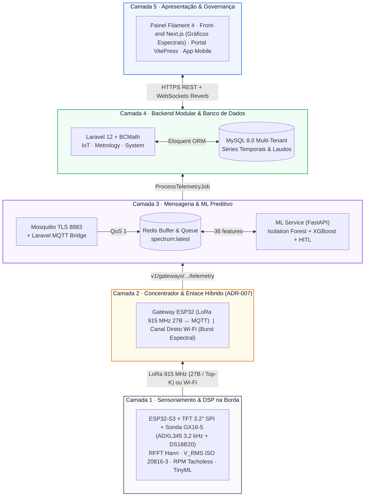

# Arquitetura Distribuída em 5 Camadas

Esta seção detalha o projeto de arquitetura de software e hardware em 5 camadas distribuídas, fundamentado no isolamento de responsabilidades e desacoplamento assíncrono via Redis.

---

## 1. Visão Geral das 5 Camadas

---

## 2. Detalhamento de Cada Camada

### Camada 1: Sensoriamento e DSP na Borda
* **Hardware:** Microcontrolador dual-core ESP32-S3 operando com amostragem direta via barramento I2C a 400 kHz.
* **Processamento:** Amostragem síncrona a 3200 Hz nos 3 eixos, janela de Hann, cálculo de FFT, aceleração de pico, fator de crista e velocidade RMS segundo a norma ISO 20816-3.

### Camada 2: Concentrador de Campo (Gateway)
* **Função:** Ponte de rádio para rede IP. Recebe os pacotes via rádio LoRa com modulação Chirp Spread Spectrum (CSS) a 915 MHz, valida o CRC-16 de hardware e converte os bytes em mensagens MQTT JSON estruturadas enviadas ao broker local.

### Camada 3: Mensageria Assíncrona e Inteligência Preditiva
* **Fila Redis:** Desacopla a recepção MQTT da persistência em disco. Evita contenção de conexões no banco de dados durante rajadas de pacotes de dezenas de nós simultâneos.
* **ML Service:** Microserviço em Python (FastAPI + XGBoost) consumindo as features estatísticas pré-calculadas para classificar padrões complexos de defeito em rolamentos (pista externa, interna, elementos rolantes ou desbalanceamento de massa).

### Camada 4: Backend Central e Regras de Negócio (Laravel 12)
* **Modularidade:** Módulos independentes (`Modules/IoT`, `Modules/Metrology`, `Modules/System`) gerenciados via arquitetura modular.
* **Precisão Matemática:** Uso mandatório da extensão `BCMath` com 6 a 8 casas decimais em todas as integrações numéricas e balanço de incerteza da ISO 17025.

### Camada 5: Apresentação e Governança
* **Painel Administrativo:** Filament 4 com componentes reativos Livewire e autenticação granular baseada em papéis (Filament Shield).
* **Push em Tempo Real:** Servidor WebSockets nativo (Laravel Reverb) transmitindo gráficos de tendência e alarmes instantaneamente sem polling HTTP.
