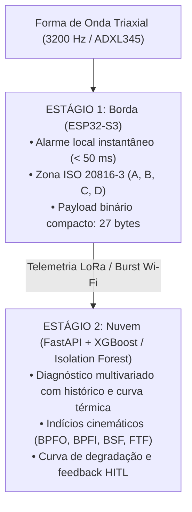

# Inferência Híbrida em 2 Estágios: TinyML vs Cloud

Esta página explica a fundamentação teórica por trás da decisão de adotar uma **arquitetura híbrida de inteligência artificial em dois estágios** para o diagnóstico preditivo em ativos rotativos industriais.

---

## 1. O Problema da Inferência Centralizada Pura

Em aplicações de manutenção preditiva industrial baseadas em análise de vibração triaxial com amostragem a 3200 Hz:
* Amostrar 1024 pontos por eixo gera 3072 pontos flutuantes por leitura.
* Transmitir toda a forma de onda bruta (*raw waveform*) por redes de rádio de baixa potência (LoRaWAN ou satélite) é energeticamente inviável: consome dezenas de segundos de transmissão e drena uma bateria em poucas semanas.
* Por outro lado, confiar exclusivamente em IA simples na borda limita a capacidade de cruzar tendências de semanas com histórico de manutenção e parâmetros térmicos operacionais.

---

## 2. A Solução: Arquitetura em 2 Estágios

---

## 3. Comparativo Funcional dos Estágios

| Critério | Estágio 1: TinyML na Borda (ESP32-S3) | Estágio 2: Cloud ML (FastAPI + XGBoost) |
| :--- | :--- | :--- |
| **Tempo de Resposta** | Ultrarrápido ($< 50\text{ ms}$) | Rápido ($< 300\text{ ms}$) |
| **Dependência de Conectividade** | Zero (opera 100% autônomo e isolado) | Requer conectividade com o broker |
| **Ação em Caso de Emergência** | Alarme visual/sonoro (`TFT 3.2"`, LEDs, Buzzer) sem intertravamento remoto (`NR-12`) | Disparo de Notificação Push, E-mail e Ordem de Serviço |
| **Entrada do Modelo** | Janela temporal de aceleração e FFT instantânea | Vetor completo de 36 features + histórico móvel e temperatura |
| **Algoritmo Utilizado** | Árvore de decisão quantizada e regras ISO | Classificador Gradiente Boosted (**XGBoost**) com SHAP values |
| **Consumo Computacional** | $\approx 120\text{ kB}$ RAM / int8 | Modelo completo em Python 3.12 com inferência paralela |

---

## 4. Conclusão da Abordagem

Essa abordagem híbrida garante o melhor dos dois mundos:
1. **Segurança de campo ininterrupta:** A máquina é protegida em tempo real contra catástrofes mecânicas mesmo com queda total do roteador ou do link de internet da fábrica.
2. **Inteligência prescritiva robusta:** Os engenheiros recebem diagnósticos ricos identificando exatamente qual pista do rolamento está desgastada e qual a gravidade da evolução de desbalanceamento.

---

## 5. Referências Científicas

* **Wang, H. et al. (2021):** *Efficient Data Reduction at the Edge of Industrial Internet of Things for PMSM Bearing Fault Diagnosis* — [`doi:10.1109/tim.2021.3051668`](https://doi.org/10.1109/tim.2021.3051668)
* **Katsoulis, S. et al. (2024):** *A LoRaWAN Vibration Detection Sensor for IoT Applications* — [`doi:10.1109/pacet60398.2024.10497014`](https://doi.org/10.1109/pacet60398.2024.10497014)
* **Di Maggio, L.; Brusa, E.; Delprete, C. (2025):** *Novelty Detection in Rotating Machinery (Isolation Forest / Unsupervised ML)* — [`doi:10.1109/iccad64771.2025.11099203`](https://doi.org/10.1109/iccad64771.2025.11099203)
* **Janssens, O. et al. (2019):** *Thermal Imaging and Vibration-Based Multisensor Fault Detection* — [`doi:10.1109/tii.2018.2873175`](https://doi.org/10.1109/tii.2018.2873175)
* Veja a lista completa em [Referências Científicas e Normativas](/explicacoes/referencias-cientificas).
