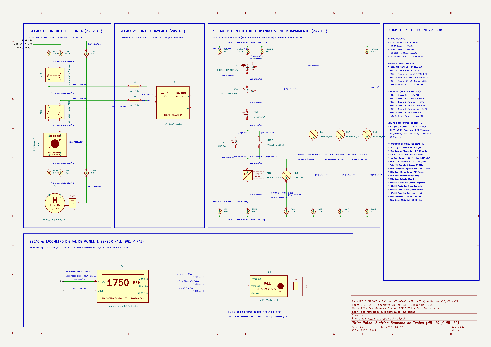
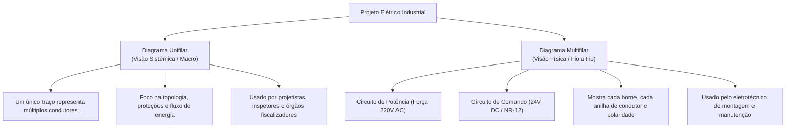
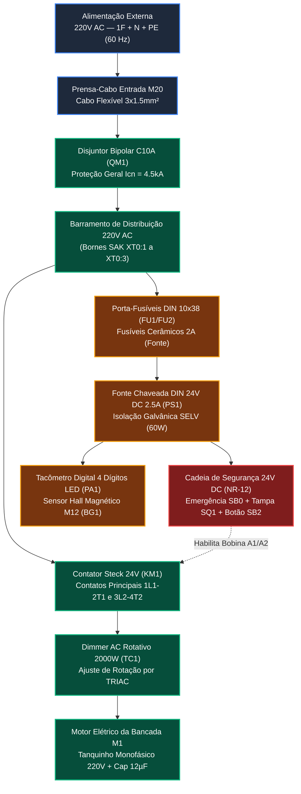
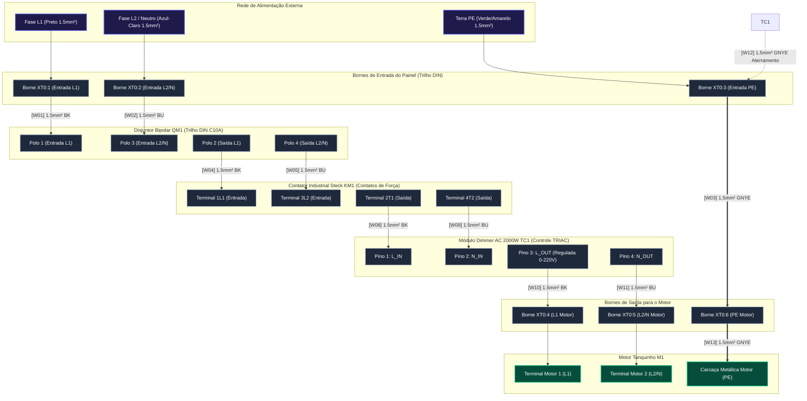
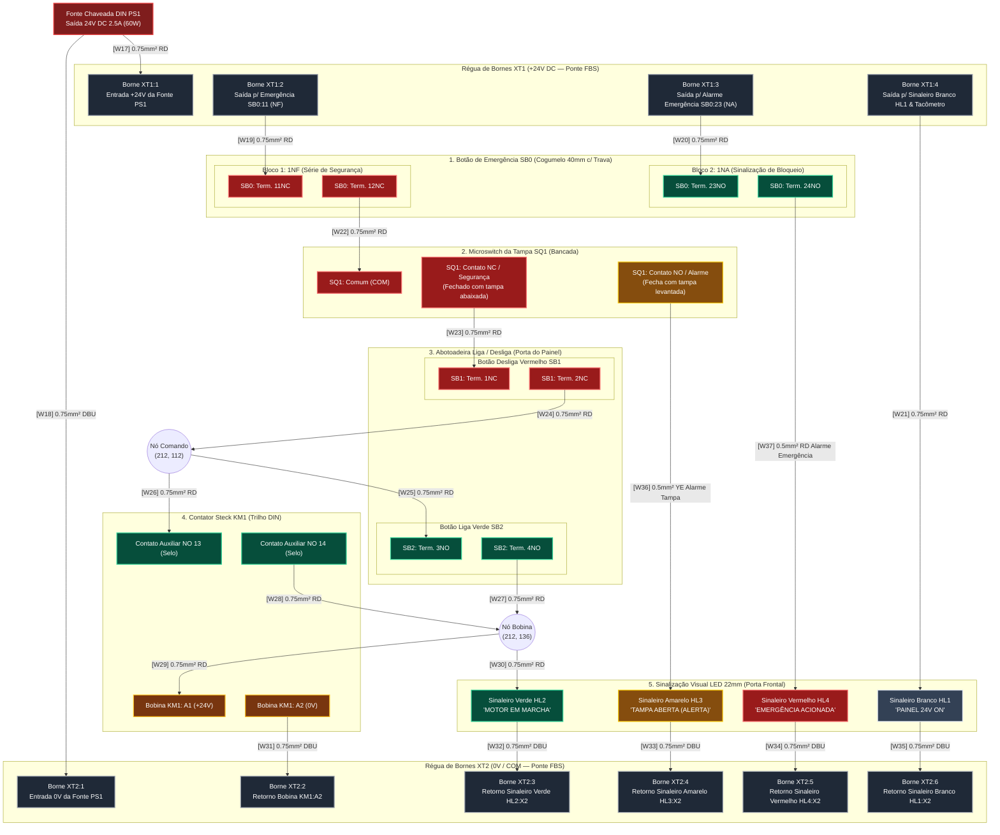

# Projeto Elétrico Industrial: Diagramas Unifilar e Multifilar
## Bancada Metrológica de Testes M1 — Sistema Lean Tech



---

## 1. O que são Diagramas Unifilar e Multifilar?

Na engenharia elétrica industrial (normas **ABNT NBR 5410**, **NR-10**, **NR-12**, **IEC 60204-1** e **IEC 81346-2**), existem formas distintas de representar uma instalação elétrica dependendo do objetivo: visão sistêmica macro ou execução física fio a fio.



### 1.1 Diagrama Unifilar
- **Conceito:** Representa todos os condutores de um circuito (fase, neutro, terra, retorno) simplificados em **uma única linha**. Sobre essa linha, traços inclinados normalizados indicam quantos e quais fios passam naquele trecho:
  - Traço longo vertical: Condutor de **Fase** ($L$).
  - Traço em "L" invertido: Condutor de **Neutro** ($N$).
  - Traço em "T": Condutor de **Proteção / Terra** ($PE$).
- **Finalidade:** Permite enxergar num relance a rota da energia: entrada da rede $\rightarrow$ disjuntor geral $\rightarrow$ barramentos $\rightarrow$ ramais de potência e comando.

### 1.2 Diagrama Multifilar
- **Conceito:** Representa **cada condutor físico individualmente com sua rota real**, identificando número de borne, terminais de componentes (ex: `A1`, `A2`, `13NO`, `14NO`), bitola em $mm^2$, identificador de anilha `[Wxx]` e código de cor IEC 60204-1.
- **Divisão Padrão:**
  1. **Circuito de Potência (Força):** Linhas de alimentação que transportam a corrente do motor (220V AC).
  2. **Circuito de Comando (Controle e Segurança):** Circuito em extra-baixa tensão de segurança (24V DC) que opera a lógica de liga/desliga, emergência e intertravamento da tampa (NR-12).

---

## 2. Diagrama Unifilar da Bancada M1

Abaixo está o diagrama unifilar que sintetiza a distribuição geral de energia no painel elétrico:



---

## 3. Diagrama Multifilar de Potência (Circuito de Força — 220V AC)

Este diagrama detalha a rota física dos condutores de potência que alimentam o disjuntor `QM1`, contator `KM1`, dimmer `TC1` e motor elétrico `M1`:



---

## 4. Diagrama Multifilar de Comando e Segurança (24V DC / NR-12)

O circuito de comando opera em **tensão contínua de segurança (24V DC)**, isolado galvanicamente da rede 220V através da fonte chaveada DIN `PS1` (protegida pelos fusíveis `FU1` e `FU2`). A distribuição de alimentação é realizada por **réguas de bornes SAK dedicadas no trilho DIN**:
- **Régua `XT1` (+24V DC):** 4 bornes interligados por ponte conectora FBS (+24V da fonte PS1, alimentação de emergência SB0, alarme e sinaleiro branco/tacômetro).
- **Régua `XT2` (0V / COM):** 6 bornes interligados por ponte conectora FBS (retorno 0V da fonte PS1, contator KM1, sinaleiros HL1/HL2/HL3/HL4 e tacômetro).

Todos os condutores recebem **anilhas industriais identificadas de `[W01]` a `[W42]` com indicação de bitola e código de cores IEC 60204-1**.



---

## 5. Circuito do Tacômetro Digital & Sensor Hall

O tacômetro mede com precisão a rotação instantânea do eixo motor através da passagem do ímã de neodímio em frente ao sensor Hall `BG1` (NJK-5002C):

```mermaid
flowchart LR
    classDef pwr fill:#7f1d1d,stroke:#ef4444,stroke-width:1.5px,color:#fff;
    classDef gnd fill:#1e1b4b,stroke:#3b82f6,stroke-width:1.5px,color:#fff;
    classDef sig fill:#78350f,stroke:#f59e0b,stroke-width:1.5px,color:#fff;
    classDef dev fill:#1e293b,stroke:#64748b,stroke-width:2px,color:#fff;

    subgraph BORNES_DISTRIBUICAO["Bornes de Distribuição DIN"]
        XT1_4["Borne XT1:4 (+24V DC)"]:::pwr
        XT2_6["Borne XT2:6 (0V / GND)"]:::gnd
    end

    subgraph TAC_DISPLAY["Tacômetro Digital 4 Dígitos LED (Painel Frontal PA1)"]
        T_VCC["Pin 1: VCC (+12V a +24V)"]:::pwr
        T_GND["Pin 2: GND (0V)"]:::gnd
        T_OUT_VCC["Pin 4: +Vcc Sensor"]:::pwr
        T_SIG["Pin 3: Signal IN (Pulso NPN)"]:::sig
        T_OUT_GND["Pin 5: GND Sensor"]:::gnd
    end

    subgraph SENSOR_HALL["Sensor Hall M12 NJK-5002C (BG1 — Bancada Mecânica)"]
        H_BRN["Pino 1: Marrom (+VCC)"]:::pwr
        H_BLK["Pino 2: Preto (Sinal NPN)"]:::sig
        H_BLU["Pino 3: Azul (GND 0V)"]:::gnd
    end

    subgraph EIXO_BANCADA["Eixo Rotativo"]
        MAGNET["Ímã de Neodímio N50<br/>Afixado na polia"]:::dev
    end

    XT1_4 -->|"[W38] 0.5mm² RD (+24V DC)"| T_VCC
    XT2_6 -->|"[W39] 0.5mm² DBU (0V DC)"| T_GND

    T_OUT_VCC -->|"[W40] 0.5mm² BN (Marrom +24V)"| H_BRN
    T_SIG <--|"[W41] 0.5mm² BK (Preto Pulso NPN)"| H_BLK
    T_OUT_GND -->|"[W42] 0.5mm² BU (Azul GND)"| H_BLU

    MAGNET -.->|"Passagem a 1-8mm do sensor"| SENSOR_HALL
```

---

## 6. Tabela De-Para Definitiva da Fiação (Wiring Schedule [W01] a [W42])

Esta tabela é o guia prático de montagem em bancada para o painelista crimpar e anilhar cada condutor, em total sincronismo com o esquema KiCad `amemiya_bancada_painel.kicad_sch` (versão v2.4):

| ID Cabo | Origem (De) | Destino (Para) | Função / Descrição | Bitola | Cor IEC 60204-1 | Terminal Recomendado |
| :---: | :--- | :--- | :--- | :---: | :---: | :---: |
| **[W01]** | Borne `XT0:1` (Entrada L1) | Disjuntor `QM1:1` | Fase 1 220V entrada geral | $1.5\text{ mm}^2$ | BK (Preto) | Ilhós 1.5mm² |
| **[W02]** | Borne `XT0:2` (Entrada L2/N) | Disjuntor `QM1:3` | Fase 2 / Neutro 220V entrada | $1.5\text{ mm}^2$ | BU (Azul Claro) | Ilhós 1.5mm² |
| **[W03]** | Borne `XT0:3` (Entrada PE) | Barramento Terra `PE` (DIN) | Aterramento geral de proteção | $1.5\text{ mm}^2$ | GNYE (Verde/Amarelo) | Ilhós 1.5mm² |
| **[W04]** | Disjuntor `QM1:2` (Saída L1) | Derivação: `KM1:1L1` e `FU1:1` | Fase L1 protegida por QM1 | $1.5\text{ mm}^2$ | BK (Preto) | Ilhós Duplo 2x1.5mm² |
| **[W05]** | Disjuntor `QM1:4` (Saída L2) | Derivação: `KM1:3L2` e `FU2:1` | Fase L2 protegida por QM1 | $1.5\text{ mm}^2$ | BU (Azul Claro) | Ilhós Duplo 2x1.5mm² |
| **[W06]** | Derivação `QM1:2` | Fusível `FU1:1` (Entrada) | Alimentação primária fonte 24V | $0.75\text{ mm}^2$ | BK (Preto) | Ilhós 0.75mm² |
| **[W07]** | Derivação `QM1:4` | Fusível `FU2:1` (Entrada) | Alimentação primária fonte 24V | $0.75\text{ mm}^2$ | BU (Azul Claro) | Ilhós 0.75mm² |
| **[W08]** | Contator `KM1:2T1` (Saída L1) | Dimmer `TC1:1` (L_IN) | Fase comutada pelo contator | $1.5\text{ mm}^2$ | BK (Preto) | Ilhós 1.5mm² |
| **[W09]** | Contator `KM1:4T2` (Saída L2) | Dimmer `TC1:2` (N_IN) | Neutro comutado por KM1 | $1.5\text{ mm}^2$ | BU (Azul Claro) | Ilhós 1.5mm² |
| **[W10]** | Dimmer `TC1:3` (L_OUT) | Borne `XT0:4` $\rightarrow$ Motor `M1:1` | Fase regulada (0-220V) para motor | $1.5\text{ mm}^2$ | BK (Preto) | Ilhós 1.5mm² |
| **[W11]** | Dimmer `TC1:4` (N_OUT) | Borne `XT0:5` $\rightarrow$ Motor `M1:2` | Retorno neutro regulado | $1.5\text{ mm}^2$ | BU (Azul Claro) | Ilhós 1.5mm² |
| **[W12]** | Barramento Terra `PE` (DIN) | Carcaça Dimmer `TC1` (PE) | Aterramento carcaça/dissipador TRIAC | $1.5\text{ mm}^2$ | GNYE (Verde/Amarelo) | Terminal Olhal M4 |
| **[W13]** | Borne `XT0:6` (Saída Terra) | Motor `M1:Carcaça PE` | Aterramento carcaça do motor | $1.5\text{ mm}^2$ | GNYE (Verde/Amarelo) | Terminal Olhal M4/M5 |
| **[W14]** | Porta-Fusível `FU1:2` (Saída 2A)| Fonte `PS1:1` (L) | Alimentação AC L da fonte 24V | $0.75\text{ mm}^2$ | BK (Preto) | Ilhós 0.75mm² |
| **[W15]** | Porta-Fusível `FU2:2` (Saída 2A)| Fonte `PS1:2` (N) | Alimentação AC N da fonte 24V | $0.75\text{ mm}^2$ | BU (Azul Claro) | Ilhós 0.75mm² |
| **[W16]** | Fonte `PS1:3` (PE) | Barramento Terra `PE` (DIN) | Aterramento de proteção da fonte | $0.75\text{ mm}^2$ | GNYE (Verde/Amarelo) | Ilhós 0.75mm² |
| **[W17]** | Fonte `PS1:4` (+24V DC) | Borne Distribuição `XT1:1` | Alimentação principal barramento +24V | $0.75\text{ mm}^2$ | RD (Vermelho) | Ilhós 0.75mm² |
| **[W18]** | Fonte `PS1:5` (0V DC) | Borne Distribuição `XT2:1` | Retorno principal barramento 0V | $0.75\text{ mm}^2$ | DBU (Azul Escuro) | Ilhós 0.75mm² |
| **[W19]** | Borne Distribuição `XT1:2` | Emergência `SB0:11NC` | Alimentação cadeia de segurança NR-12 | $0.75\text{ mm}^2$ | RD (Vermelho) | Ilhós 0.75mm² |
| **[W20]** | Borne Distribuição `XT1:3` | Emergência `SB0:23NO` | Alimentação sinal alarme emergência | $0.75\text{ mm}^2$ | RD (Vermelho) | Ilhós 0.75mm² |
| **[W21]** | Borne Distribuição `XT1:4` | Sinaleiro Branco `HL1:X1` | Alimentação LED Standby (Painel ON) | $0.75\text{ mm}^2$ | RD (Vermelho) | Ilhós 0.75mm² |
| **[W22]** | Emergência `SB0:12NC` | Microswitch `SQ1:COM` | Série de segurança porta/tampa | $0.75\text{ mm}^2$ | RD (Vermelho) | Faston isolado 6.3mm |
| **[W23]** | Microswitch `SQ1:NC` | Botão Desliga `SB1:1NC` | Série de segurança para porta painel | $0.75\text{ mm}^2$ | RD (Vermelho) | Ilhós 0.75mm² |
| **[W24]** | Botão Desliga `SB1:2NC` | Nó de Comando `(212, 112)` | Saída do botão desliga | $0.75\text{ mm}^2$ | RD (Vermelho) | Ilhós 0.75mm² |
| **[W25]** | Nó de Comando `(212, 112)` | Botão Liga `SB2:3NO` | Entrada do pulso liga | $0.75\text{ mm}^2$ | RD (Vermelho) | Ilhós 0.75mm² |
| **[W26]** | Nó de Comando `(212, 112)` | Contator `KM1:13NO` (Selo) | Alimentação contato de retenção | $0.75\text{ mm}^2$ | RD (Vermelho) | Ilhós 0.75mm² |
| **[W27]** | Botão Liga `SB2:4NO` | Nó Bobina `(212, 136)` | Pulso liga para bobina | $0.75\text{ mm}^2$ | RD (Vermelho) | Ilhós 0.75mm² |
| **[W28]** | Contator `KM1:14NO` (Selo) | Nó Bobina `(212, 136)` | Fechamento do selo de retenção | $0.75\text{ mm}^2$ | RD (Vermelho) | Ilhós Duplo 2x0.75mm² |
| **[W29]** | Nó Bobina `(212, 136)` | Contator `KM1:A1` (+ Bobina 24V) | Alimentação positiva da bobina KM1 | $0.75\text{ mm}^2$ | RD (Vermelho) | Ilhós 0.75mm² |
| **[W30]** | Nó Bobina `(212, 136)` | Sinaleiro Verde `HL2:X1` | Paralelo: LED "Motor em Marcha" | $0.75\text{ mm}^2$ | RD (Vermelho) | Ilhós 0.75mm² |
| **[W31]** | Contator `KM1:A2` (- Bobina 0V) | Borne Distribuição `XT2:2` | Retorno 0V bobina do contator | $0.75\text{ mm}^2$ | DBU (Azul Escuro) | Ilhós 0.75mm² |
| **[W32]** | Sinaleiro Verde `HL2:X2` | Borne Distribuição `XT2:3` | Retorno 0V sinaleiro motor em marcha | $0.75\text{ mm}^2$ | DBU (Azul Escuro) | Ilhós 0.75mm² |
| **[W33]** | Sinaleiro Amarelo `HL3:X2` | Borne Distribuição `XT2:4` | Retorno 0V sinaleiro tampa aberta | $0.75\text{ mm}^2$ | DBU (Azul Escuro) | Ilhós 0.75mm² |
| **[W34]** | Sinaleiro Vermelho `HL4:X2` | Borne Distribuição `XT2:5` | Retorno 0V sinaleiro emergência | $0.75\text{ mm}^2$ | DBU (Azul Escuro) | Ilhós 0.75mm² |
| **[W35]** | Sinaleiro Branco `HL1:X2` | Borne Distribuição `XT2:6` | Retorno 0V sinaleiro painel energizado | $0.75\text{ mm}^2$ | DBU (Azul Escuro) | Ilhós 0.75mm² |
| **[W36]** | Microswitch `SQ1:NO` (NA) | Sinaleiro Amarelo `HL3:X1` | Sinal de alerta "Tampa Aberta" | $0.5\text{ mm}^2$ | YE (Amarelo) | Faston / Ilhós 0.5mm² |
| **[W37]** | Emergência `SB0:24NO` (NA) | Sinaleiro Vermelho `HL4:X1` | Sinal de alarme "Emergência Acionada" | $0.5\text{ mm}^2$ | RD (Vermelho) | Ilhós 0.5mm² |
| **[W38]** | Borne Distribuição `XT1:4` (+24V) | Tacômetro `PA1:1` (VCC +24V) | Alimentação display digital RPM | $0.5\text{ mm}^2$ | RD (Vermelho) | Ilhós 0.5mm² |
| **[W39]** | Borne Distribuição `XT2:6` (0V) | Tacômetro `PA1:2` (GND 0V) | Retorno 0V display RPM | $0.5\text{ mm}^2$ | DBU (Azul Escuro) | Ilhós 0.5mm² |
| **[W40]** | Tacômetro `PA1:4` (+V Sensor) | Sensor Hall `BG1:1` (Marrom +) | Alimentação +24V sensor magnético M12 | $0.5\text{ mm}^2$ | BN (Marrom) | Terminal Prensa / Ilhós |
| **[W41]** | Tacômetro `PA1:3` (Signal In) | Sensor Hall `BG1:2` (Preto Sig) | Sinal de pulso rotação NPN coletor aberto | $0.5\text{ mm}^2$ | BK (Preto) | Terminal Prensa / Ilhós |
| **[W42]** | Tacômetro `PA1:5` (GND Sensor) | Sensor Hall `BG1:3` (Azul 0V) | Retorno 0V GND sensor magnético M12 | $0.5\text{ mm}^2$ | BU (Azul Claro) | Terminal Prensa / Ilhós |

---

## 7. Recomendações Críticas de Montagem e Segurança (NR-10 & NR-12)

> [!IMPORTANT]
> 1. **Separação Galvânica e Fiação em Canaletas:**
>    - Nunca passe cabos de potência 220V AC junto com os cabos de sinal do sensor Hall ou de comunicação da sonda IoT na mesma canaleta ranhurada. Mantenha canaletas separadas para evitar indução eletromagnética e ruído de leitura no tacômetro.
>
> 2. **Espaguete Espiral na Porta do Painel:**
>    - Toda a fiação flexível que vai da placa de montagem para a tampa frontal articulada (botão de emergência `SB0`, botões `SB1`/`SB2`, sinaleiros `HL1`-`HL4` e tacômetro `PA1`) deve ser protegida por espaguete espiral plástico para evitar desgaste por abrasão mecânica nas dobradiças.
>
> 3. **Aterramento Equipotencial da Placa Metálica e da Porta:**
>    - A placa de montagem de fundo e a porta de chapa de aço devem ser aterradas ao borne PE através de uma cordoalha de cobre flexível de $2.5\text{ mm}^2$.
>
> 4. **Ação Positiva de Segurança:**
>    - Se a tampa de acrílico for levantada durante a operação do motor, o contato NC do microswitch `SQ1` se abre instantaneamente, derrubando a retenção da bobina do contator `KM1` em menos de $15\text{ ms}$. Mesmo se a tampa for fechada novamente, o motor **NÃO** religa sozinho (exige um novo aperto deliberado no botão verde de Liga `SB2`), cumprindo a exigência de proteção contra partida intempestiva da NR-12.
