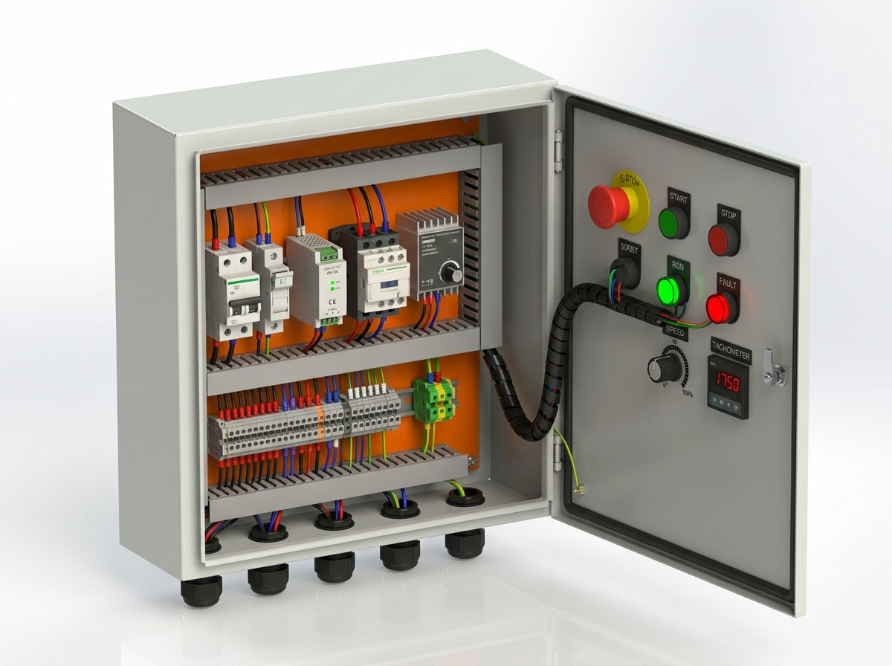
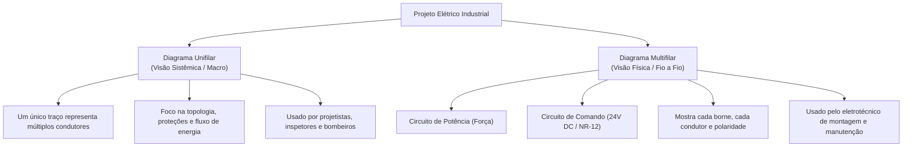
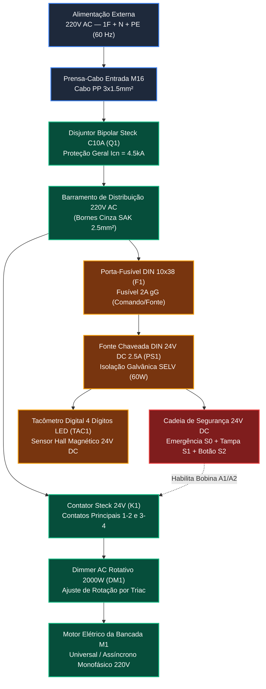
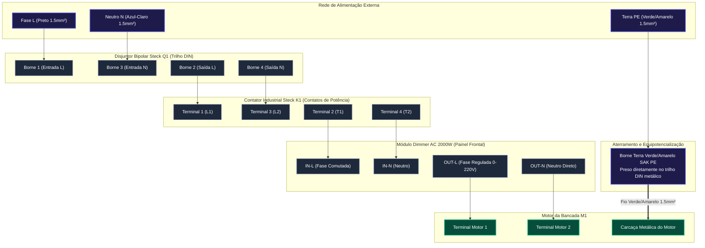
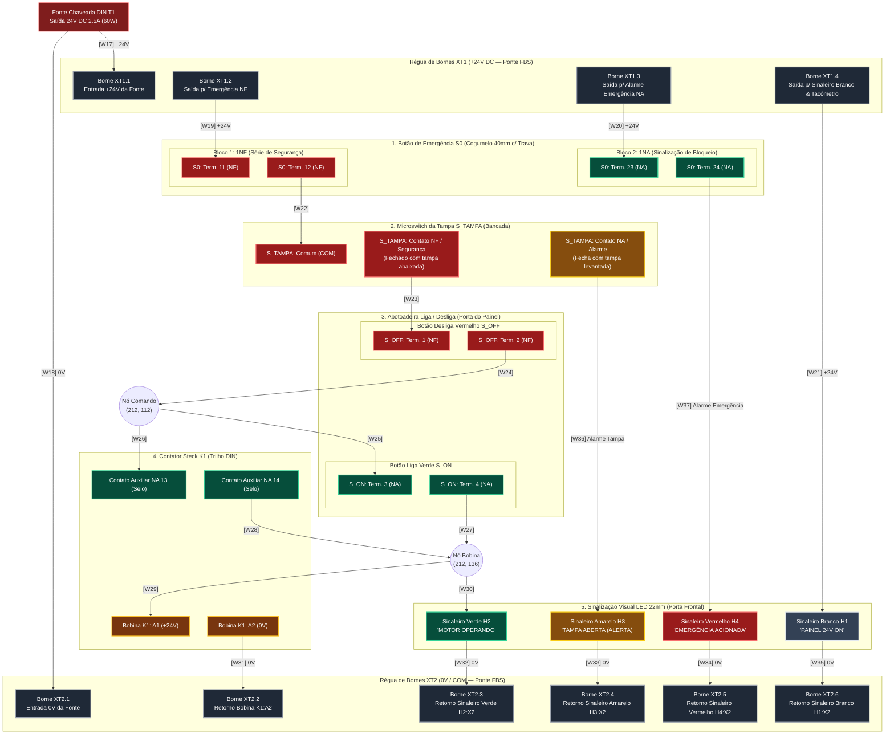

# Projeto Elétrico Industrial: Diagramas Unifilar e Multifilar
## Bancada Metrológica de Testes M1 — Sistema Lean Tech



---

## 1. O que são Diagramas Unifilar e Multifilar?

Na engenharia elétrica industrial (normas **ABNT NBR 5410**, **NR-10**, **NR-12** e **IEC 60617**), existem formas distintas de representar uma instalação elétrica dependendo do objetivo: visão sistêmica macro ou execução física fio a fio.



### 1.1 Diagrama Unifilar
- **Conceito:** Representa todos os condutores de um circuito (fase, neutro, terra, retorno) simplificados em **uma única linha**. Sobre essa linha, traços inclinados normalizados indicam quantos e quais fios passam naquele trecho:
  - Traço longo vertical: Condutor de **Fase** ($L$).
  - Traço em "L" invertido: Condutor de **Neutro** ($N$).
  - Traço em "T": Condutor de **Proteção / Terra** ($PE$).
- **Finalidade:** Permite enxergar num relance a rota da energia: entrada da rede $\rightarrow$ disjuntor geral $\rightarrow$ barramentos $\rightarrow$ ramais de potência e comando.

### 1.2 Diagrama Multifilar
- **Conceito:** Representa **cada condutor físico individualmente com sua rota real**, identificando número de borne, terminais de componentes (ex: `A1`, `A2`, `13`, `14`), bitola em $mm^2$ e cor da fiação.
- **Divisão Padrão:**
  1. **Circuito de Potência (Força):** Linhas de alimentação que transportam a corrente pesada do motor (220V AC).
  2. **Circuito de Comando (Controle e Segurança):** Circuito em extra-baixa tensão de segurança (24V DC) que opera a lógica de liga/desliga, emergência e intertravamento de segurança.

---

## 2. Diagrama Unifilar da Bancada M1

Abaixo está o diagrama unifilar que sintetiza a distribuição geral de energia no painel elétrico:



---

## 3. Diagrama Multifilar de Potência (Circuito de Força — 220V AC)

Este diagrama detalha a rota física dos condutores de potência que alimentam o contator, dimmer e motor elétrico:



---

## 4. Diagrama Multifilar de Comando e Segurança (24V DC / NR-12)

O circuito de comando opera em **tensão contínua de segurança (24V DC)**, isolado galvanicamente da rede 220V através da fonte chaveada DIN `T1`. A distribuição de alimentação é realizada por **réguas de bornes SAK dedicadas no trilho DIN**:
- **Régua `XT1` (+24V DC):** 4 bornes interligados por ponte conectora FBS (+24V da fonte, alimentação de segurança S0, alarme e sinaleiro branco/tacômetro).
- **Régua `XT2` (0V / COM):** 6 bornes interligados por ponte conectora FBS (retorno 0V da fonte, contator K1, sinaleiros H1/H2/H3/H4 e tacômetro).

Todos os condutores recebem **anilhas industriais identificadas de `[W01]` a `[W42]`**.



---

## 5. Circuito do Tacômetro Digital & Sensor Hall

O tacômetro mede com precisão a rotação instantânea do eixo motor através da passagem do ímã de neodímio em frente ao sensor Hall `SEN_HALL`:

```mermaid
flowchart LR
    classDef pwr fill:#7f1d1d,stroke:#ef4444,stroke-width:1.5px,color:#fff;
    classDef gnd fill:#1e1b4b,stroke:#3b82f6,stroke-width:1.5px,color:#fff;
    classDef sig fill:#78350f,stroke:#f59e0b,stroke-width:1.5px,color:#fff;
    classDef dev fill:#1e293b,stroke:#64748b,stroke-width:2px,color:#fff;

    subgraph BORNES_DISTRIBUICAO["Bornes de Distribuição DIN"]
        XT1_4["Borne XT1.4 (+24V DC)"]:::pwr
        XT2_6["Borne XT2.6 (0V / GND)"]:::gnd
    end

    subgraph TAC_DISPLAY["Tacômetro Digital 4 Dígitos LED (Painel Frontal DISP1)"]
        T_VCC["Pin 1: VCC (+12V a +24V)"]:::pwr
        T_GND["Pin 2: GND (0V)"]:::gnd
        T_OUT_VCC["Pin 4: +Vcc Sensor"]:::pwr
        T_SIG["Pin 3: Signal IN (Pulso NPN)"]:::sig
        T_OUT_GND["Pin 5: GND Sensor"]:::gnd
    end

    subgraph SENSOR_HALL["Sensor Hall M12 NJK-5002C (Bancada Mecânica)"]
        H_BRN["Pino 1: Marrom (+VCC)"]:::pwr
        H_BLK["Pino 2: Preto (Sinal NPN)"]:::sig
        H_BLU["Pino 3: Azul (GND 0V)"]:::gnd
    end

    subgraph EIXO_BANCADA["Eixo Rotativo"]
        MAGNET["Ímã de Neodímio N50<br/>Afixado na polia"]:::dev
    end

    XT1_4 -->|"[W38] +24V DC"| T_VCC
    XT2_6 -->|"[W39] 0V DC"| T_GND

    T_OUT_VCC -->|"[W40] Marrom (+24V)"| H_BRN
    T_SIG <--|"[W41] Preto (Pulso NPN)"| H_BLK
    T_OUT_GND -->|"[W42] Azul (GND)"| H_BLU

    MAGNET -.->|"Passagem a 1-8mm do sensor"| SENSOR_HALL
```

---

## 6. Tabela De-Para Definitiva da Fiação (Wiring Schedule [W01] a [W42])

Esta tabela é o guia prático de montagem em bancada para o painelista crimpar e anilhar cada condutor, em total sincronismo com o esquema KiCad `amemiya_bancada_painel.kicad_sch` (versão v2.3):

| ID Cabo | Origem (De) | Destino (Para) | Função / Descrição | Bitola | Cor Normatizada | Terminal Recomendado |
| :---: | :--- | :--- | :--- | :---: | :---: | :---: |
| **[W01]** | Borne `TB1:2` (Entrada L1) | Disjuntor `Q1:1` | Fase 1 220V entrada geral | $1.5\text{ mm}^2$ | Preto | Ilhós 1.5mm² |
| **[W02]** | Borne `TB2:2` (Entrada L2/N) | Disjuntor `Q1:3` | Fase 2 / Neutro 220V entrada | $1.5\text{ mm}^2$ | Azul-claro | Ilhós 1.5mm² |
| **[W03]** | Borne `TB3:2` (Entrada PE) | Barramento Terra `PE` (DIN) | Aterramento geral de proteção | $1.5\text{ mm}^2$ | Verde/Amarelo | Ilhós 1.5mm² |
| **[W04]** | Disjuntor `Q1:2` (Saída L1) | Derivação: `K1:1L1` e `F1:1` | Fase L1 protegida por Q1 | $1.5\text{ mm}^2$ | Preto | Ilhós Duplo 2x1.5mm² |
| **[W05]** | Disjuntor `Q1:4` (Saída L2) | Derivação: `K1:3L2` e `F2:1` | Fase L2 protegida por Q1 | $1.5\text{ mm}^2$ | Azul-claro | Ilhós Duplo 2x1.5mm² |
| **[W06]** | Contator `K1:2T1` (Saída L1) | Dimmer `DIM1:L_IN` | Fase comutada pelo contator | $1.5\text{ mm}^2$ | Preto | Ilhós 1.5mm² |
| **[W07]** | Contator `K1:4T2` (Saída L2) | Dimmer `DIM1:N_IN` | Neutro comutado por K1 | $1.5\text{ mm}^2$ | Azul-claro | Ilhós 1.5mm² |
| **[W08]** | Dimmer `DIM1:L_OUT` | Borne `TB4:1` (Saída Motor L) | Fase regulada (0-220V) para motor | $1.5\text{ mm}^2$ | Preto | Ilhós 1.5mm² |
| **[W09]** | Dimmer `DIM1:N_OUT` | Borne `TB5:1` (Saída Motor N) | Retorno neutro regulado | $1.5\text{ mm}^2$ | Azul-claro | Ilhós 1.5mm² |
| **[W10]** | Borne `TB4:2` (Saída Painel) | Motor `M1:Fase` (Chicote ext.) | Alimentação fase motor bancada | $1.5\text{ mm}^2$ | Preto (Cabo PP) | Ilhós / Faston motor |
| **[W11]** | Borne `TB5:2` (Saída Painel) | Motor `M1:Neutro` (Chicote ext.) | Retorno neutro motor bancada | $1.5\text{ mm}^2$ | Azul (Cabo PP) | Ilhós / Faston motor |
| **[W12]** | Borne `TB6:2` (Saída Terra) | Motor `M1:Carcaça PE` | Aterramento carcaça do motor | $1.5\text{ mm}^2$ | Verde/Amarelo | Terminal Olhal M4/M5 |
| **[W13]** | Barramento Terra `PE` (DIN) | Borne `TB6:1` | Interligação PE painel ao borne motor | $1.5\text{ mm}^2$ | Verde/Amarelo | Ilhós 1.5mm² |
| **[W14]** | Porta-Fusível `F1:2` (Saída 2A) | Fonte `T1:L` (Pino 1) | Alimentação AC L da fonte 24V | $0.75\text{ mm}^2$ | Preto | Ilhós 0.75mm² |
| **[W15]** | Porta-Fusível `F2:2` (Saída 2A) | Fonte `T1:N` (Pino 2) | Alimentação AC N da fonte 24V | $0.75\text{ mm}^2$ | Azul-claro | Ilhós 0.75mm² |
| **[W16]** | Fonte `T1:PE` (Pino 3) | Barramento Terra `PE` (DIN) | Aterramento carcaça da fonte DIN | $0.75\text{ mm}^2$ | Verde/Amarelo | Ilhós 0.75mm² |
| **[W17]** | Fonte `T1:+V` (Pino 4, +24V) | Borne Distribuição `XT1.1:1` | Alimentação principal barramento +24V | $0.75\text{ mm}^2$ | Vermelho | Ilhós 0.75mm² |
| **[W18]** | Fonte `T1:-V` (Pino 5, 0V) | Borne Distribuição `XT2.1:1` | Retorno principal barramento 0V | $0.75\text{ mm}^2$ | Azul-escuro / Preto | Ilhós 0.75mm² |
| **[W19]** | Borne Distribuição `XT1.2:1` | Emergência `S0:11` (NF entrada) | Alimentação cadeia de segurança NR-12 | $0.75\text{ mm}^2$ | Vermelho | Ilhós 0.75mm² |
| **[W20]** | Borne Distribuição `XT1.3:1` | Emergência `S0:23` (NA entrada) | Alimentação sinal alarme emergência | $0.75\text{ mm}^2$ | Vermelho | Ilhós 0.75mm² |
| **[W21]** | Borne Distribuição `XT1.4:1` | Sinaleiro Branco `H1:X1` (+) | Alimentação LED Standby (Painel ON) | $0.5\text{ mm}^2$ | Vermelho / Branco | Ilhós 0.5mm² |
| **[W22]** | Emergência `S0:12` (NF saída) | Microswitch `S_TAMPA:COM` | Série de segurança porta/tampa | $0.75\text{ mm}^2$ | Vermelho | Faston isolado 6.3mm |
| **[W23]** | Microswitch `S_TAMPA:NC` (NF) | Botão Desliga `S_OFF:1` (NF) | Série de segurança para porta painel | $0.75\text{ mm}^2$ | Vermelho | Ilhós 0.75mm² |
| **[W24]** | Botão Desliga `S_OFF:2` (NF) | Nó de Comando `(212, 112)` | Saída do botão desliga | $0.75\text{ mm}^2$ | Vermelho | Ilhós 0.75mm² |
| **[W25]** | Nó de Comando `(212, 112)` | Botão Liga `S_ON:3` (NA entrada) | Entrada do pulso liga | $0.75\text{ mm}^2$ | Vermelho | Ilhós 0.75mm² |
| **[W26]** | Nó de Comando `(212, 112)` | Contator `K1_SELO:13` (NA) | Alimentação contato de auto-retenção | $0.75\text{ mm}^2$ | Vermelho | Ilhós 0.75mm² |
| **[W27]** | Botão Liga `S_ON:4` (NA saída) | Nó Bobina `(212, 136)` | Pulso liga para bobina | $0.75\text{ mm}^2$ | Vermelho | Ilhós 0.75mm² |
| **[W28]** | Contator `K1_SELO:14` (NA) | Nó Bobina `(212, 136)` | Fechamento do selo de retenção | $0.75\text{ mm}^2$ | Vermelho | Ilhós Duplo 2x0.75mm² |
| **[W29]** | Nó Bobina `(212, 136)` | Contator `K1:A1` (+ Bobina 24V) | Alimentação positiva da bobina K1 | $0.75\text{ mm}^2$ | Vermelho | Ilhós 0.75mm² |
| **[W30]** | Nó Bobina `(212, 136)` | Sinaleiro Verde `H2:X1` (+) | Paralelo: LED "Motor Operando" | $0.5\text{ mm}^2$ | Vermelho | Ilhós 0.5mm² |
| **[W31]** | Contator `K1:A2` (- Bobina 0V) | Borne Distribuição `XT2.2:1` | Retorno 0V bobina do contator | $0.75\text{ mm}^2$ | Azul-escuro / Preto | Ilhós 0.75mm² |
| **[W32]** | Sinaleiro Verde `H2:X2` (-) | Borne Distribuição `XT2.3:1` | Retorno 0V sinaleiro motor | $0.5\text{ mm}^2$ | Azul-escuro / Preto | Ilhós 0.5mm² |
| **[W33]** | Sinaleiro Amarelo `H3:X2` (-) | Borne Distribuição `XT2.4:1` | Retorno 0V sinaleiro tampa | $0.5\text{ mm}^2$ | Azul-escuro / Preto | Ilhós 0.5mm² |
| **[W34]** | Sinaleiro Vermelho `H4:X2` (-) | Borne Distribuição `XT2.5:1` | Retorno 0V sinaleiro emergência | $0.5\text{ mm}^2$ | Azul-escuro / Preto | Ilhós 0.5mm² |
| **[W35]** | Sinaleiro Branco `H1:X2` (-) | Borne Distribuição `XT2.6:1` | Retorno 0V sinaleiro painel energizado | $0.5\text{ mm}^2$ | Azul-escuro / Preto | Ilhós 0.5mm² |
| **[W36]** | Microswitch `S_TAMPA:NO` (NA) | Sinaleiro Amarelo `H3:X1` (+) | Sinal de alerta "Tampa Aberta" | $0.5\text{ mm}^2$ | Amarelo / Laranja | Faston / Ilhós 0.5mm² |
| **[W37]** | Emergência `S0:24` (NA saída) | Sinaleiro Vermelho `H4:X1` (+) | Sinal de alarme "Emergência Acionada" | $0.5\text{ mm}^2$ | Vermelho | Ilhós 0.5mm² |
| **[W38]** | Borne Distribuição `XT1.4` (+24V) | Tacômetro `DISP1:1` (VCC +24V) | Alimentação display digital RPM | $0.5\text{ mm}^2$ | Vermelho | Ilhós 0.5mm² |
| **[W39]** | Borne Distribuição `XT2.6` (0V) | Tacômetro `DISP1:2` (GND 0V) | Retorno terra 0V display RPM | $0.5\text{ mm}^2$ | Azul-escuro / Preto | Ilhós 0.5mm² |
| **[W40]** | Tacômetro `DISP1:4` (+V Sensor) | Sensor Hall `SEN_HALL:1` (Marrom)| Alimentação +24V sensor magnético M12 | $0.5\text{ mm}^2$ | Marrom | Terminal Prensa / Ilhós |
| **[W41]** | Tacômetro `DISP1:3` (Signal In) | Sensor Hall `SEN_HALL:2` (Preto) | Sinal de pulso rotação NPN coletor aberto | $0.5\text{ mm}^2$ | Preto | Terminal Prensa / Ilhós |
| **[W42]** | Tacômetro `DISP1:5` (GND Sensor) | Sensor Hall `SEN_HALL:3` (Azul) | Retorno 0V GND sensor magnético M12 | $0.5\text{ mm}^2$ | Azul | Terminal Prensa / Ilhós |

---

## 7. Recomendações Críticas de Montagem e Segurança (NR-10 & NR-12)

> [!IMPORTANT]
> 1. **Separação Galvânica e Fiação em Canaletas:**
>    - Nunca passe cabos de potência 220V AC junto com os cabos de sinal do sensor Hall ou de comunicação da sonda IoT na mesma canaleta ranhurada. Mantenha canaletas separadas para evitar indução eletromagnética e ruído de leitura no tacômetro.
>
> 2. **Espaguete Espiral na Porta do Painel:**
>    - Toda a fiação flexível que vai da placa de montagem para a tampa frontal articulada (botão de emergência, botão duplo, dimmer e tacômetro) deve ser protegida por espaguete espiral plástico para evitar desgaste por abrasão mecânica nas dobradiças.
>
> 3. **Aterramento Equipotencial da Placa Metálica e da Porta:**
>    - A placa de montagem de fundo e a porta de chapa de aço devem ser aterradas ao borne PE através de uma cordoalha de cobre flexível de $2.5\text{ mm}^2$.
>
> 4. **Ação Positiva de Segurança:**
>    - Se a tampa de acrílico for levantada durante a operação do motor, o contato NF do microswitch se abre instantaneamente, derrubando a retenção da bobina do contator em menos de $15\text{ ms}$. Mesmo se a tampa for fechada novamente, o motor **NÃO** religa sozinho (exige um novo aperto deliberado no botão verde de Liga), cumprindo a exigência de proteção contra partida intempestiva da NR-12.
