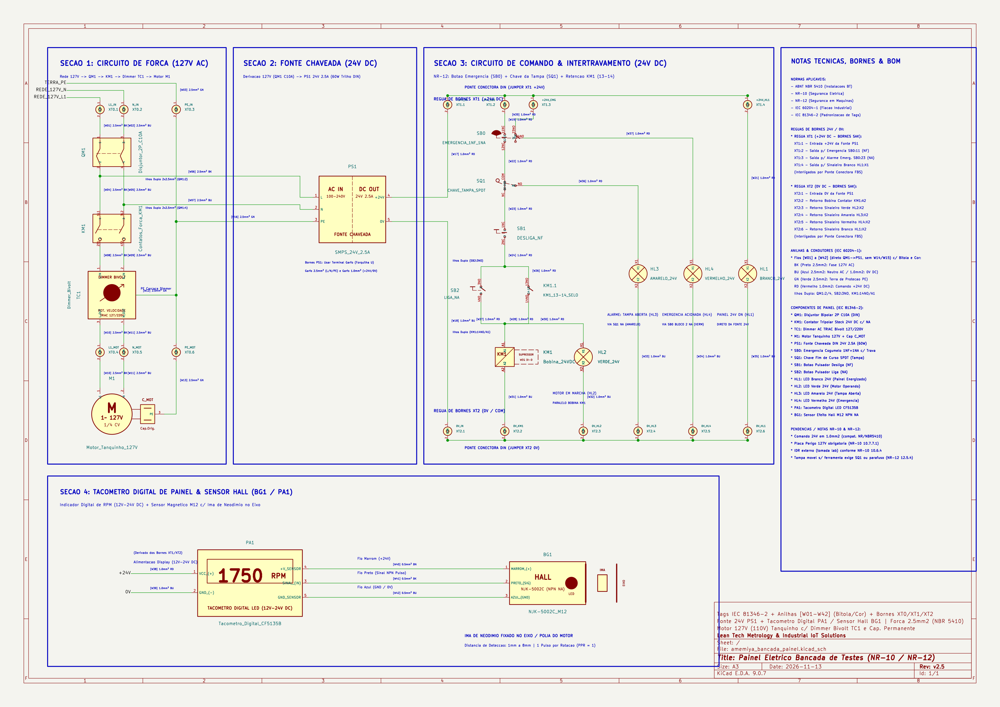
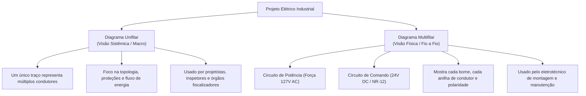
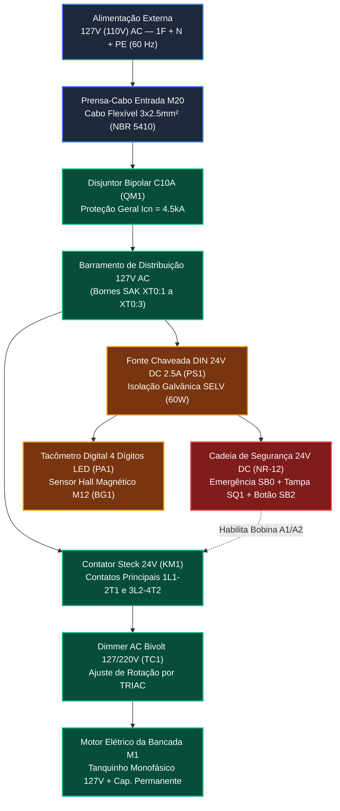
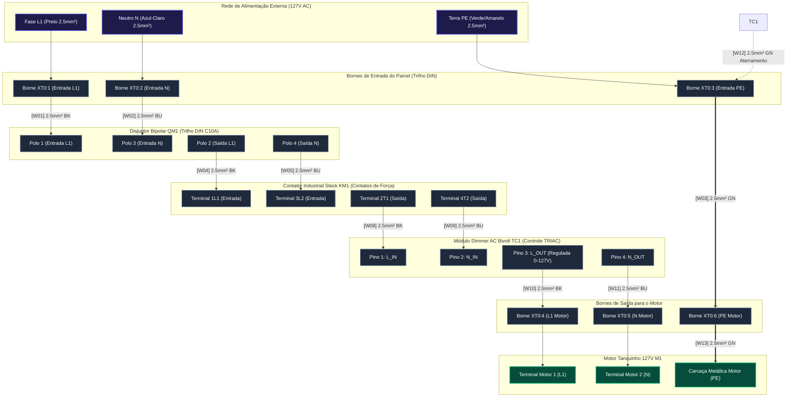
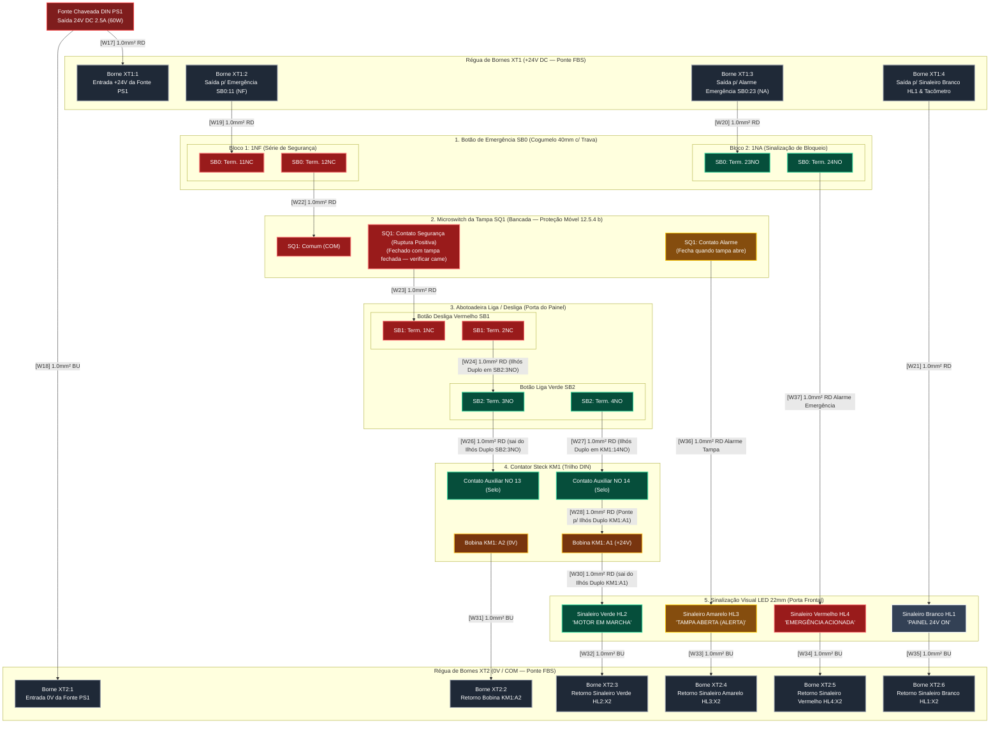

# Projeto Elétrico Industrial: Diagramas Unifilar e Multifilar
## Bancada Metrológica de Testes M1 — Sistema Lean Tech



---

## 1. O que são Diagramas Unifilar e Multifilar?

Na engenharia elétrica industrial (normas **ABNT NBR 5410**, **NR-10**, **NR-12**, **IEC 60204-1** e **IEC 81346-2**), existem formas distintas de representar uma instalação elétrica dependendo do objetivo: visão sistêmica macro ou execução física fio a fio.



### 1.1 Diagrama Unifilar
- **Conceito:** Representa todos os condutores de um circuito (fase, neutro, terra, retorno) simplificados em **uma única linha**. Sobre essa linha, traços inclinados normalizados indicam quantos e quais fios passam naquele trecho:
  - Traço longo vertical: Condutor de **Fase** ($L$).
  - Traço em "L" invertido: Condutor de **Neutro** ($N$).
  - Traço em "T": Condutor de **Proteção / Terra** ($PE$).
- **Finalidade:** Permite enxergar num relance a rota da energia: entrada da rede $\rightarrow$ disjuntor geral $\rightarrow$ barramentos $\rightarrow$ ramais de potência e comando.

### 1.2 Diagrama Multifilar
- **Conceito:** Representa **cada condutor físico individualmente com sua rota real**, identificando número de borne, terminais de componentes (ex: `A1`, `A2`, `13NO`, `14NO`), bitola em $mm^2$, identificador de anilha `[Wxx]` e código de cor IEC 60204-1.
- **Divisão Padrão:**
  1. **Circuito de Potência (Força):** Linhas de alimentação que transportam a corrente do motor (127V / 110V AC monofásico Fase + Neutro + PE).
  2. **Circuito de Comando (Controle e Segurança):** Circuito em extra-baixa tensão de segurança (24V DC) que opera a lógica de liga/desliga, emergência e intertravamento da tampa (NR-12).

---

## 2. Diagrama Unifilar da Bancada M1

Abaixo está o diagrama unifilar que sintetiza a distribuição geral de energia no painel elétrico:



---

## 3. Diagrama Multifilar de Potência (Circuito de Força — 127V AC)

Este diagrama detalha a rota física dos condutores de potência (seção mínima **2.5 mm²** conforme **ABNT NBR 5410 Tabela 47**) que alimentam o disjuntor `QM1`, contator `KM1`, dimmer `TC1` e motor elétrico `M1`:



---

## 4. Diagrama Multifilar de Comando e Segurança (24V DC / NR-12)

O circuito de comando opera em **tensão contínua de segurança (24V DC)**, isolado galvanicamente da rede 127V AC através da fonte chaveada DIN `PS1` (100-240V AC, alimentada diretamente após o disjuntor bipolar `QM1` C10A). A distribuição de alimentação é realizada por **réguas de bornes SAK dedicadas no trilho DIN**:
- **Régua `XT1` (+24V DC):** 4 bornes interligados por ponte conectora FBS (+24V da fonte PS1, alimentação de emergência SB0, alarme e sinaleiro branco/tacômetro).
- **Régua `XT2` (0V / COM):** 6 bornes interligados por ponte conectora FBS (retorno 0V da fonte PS1, contator KM1, sinaleiros HL1/HL2/HL3/HL4 e tacômetro).

Todos os condutores recebem **anilhas industriais identificadas de `[W01]` a `[W42]` com indicação de bitola e código de cores IEC 60204-1**.



---

## 5. Circuito do Tacômetro Digital & Sensor Hall

O tacômetro mede com precisão a rotação instantânea do eixo motor através da passagem do ímã de neodímio em frente ao sensor Hall `BG1` (NJK-5002C):

```mermaid
flowchart LR
    classDef pwr fill:#7f1d1d,stroke:#ef4444,stroke-width:1.5px,color:#fff;
    classDef gnd fill:#1e1b4b,stroke:#3b82f6,stroke-width:1.5px,color:#fff;
    classDef sig fill:#78350f,stroke:#f59e0b,stroke-width:1.5px,color:#fff;
    classDef dev fill:#1e293b,stroke:#64748b,stroke-width:2px,color:#fff;

    subgraph BORNES_DISTRIBUICAO["Bornes de Distribuição DIN"]
        XT1_4["Borne XT1:4 (+24V DC)"]:::pwr
        XT2_6["Borne XT2:6 (0V / GND)"]:::gnd
    end

    subgraph TAC_DISPLAY["Tacômetro Digital 4 Dígitos LED (Painel Frontal PA1)"]
        T_VCC["Pin 1: VCC (+12V a +24V)"]:::pwr
        T_GND["Pin 2: GND (0V)"]:::gnd
        T_OUT_VCC["Pin 4: +Vcc Sensor"]:::pwr
        T_SIG["Pin 3: Signal IN (Pulso NPN)"]:::sig
        T_OUT_GND["Pin 5: GND Sensor"]:::gnd
    end

    subgraph SENSOR_HALL["Sensor Hall M12 NJK-5002C (BG1 — Bancada Mecânica)"]
        H_BRN["Pino 1: Marrom (+VCC)"]:::pwr
        H_BLK["Pino 2: Preto (Sinal NPN)"]:::sig
        H_BLU["Pino 3: Azul (GND 0V)"]:::gnd
    end

    subgraph EIXO_BANCADA["Eixo Rotativo"]
        MAGNET["Ímã de Neodímio N50<br/>Afixado na polia"]:::dev
    end

    XT1_4 -->|"[W38] 1.0mm² RD (+24V DC)"| T_VCC
    XT2_6 -->|"[W39] 1.0mm² BU (0V DC)"| T_GND

    T_OUT_VCC -->|"[W40] 0.5mm² BN (Marrom +24V)"| H_BRN
    T_SIG <--|"[W41] 0.5mm² BK (Preto Pulso NPN)"| H_BLK
    T_OUT_GND -->|"[W42] 0.5mm² BU (Azul GND)"| H_BLU

    MAGNET -.->|"Passagem a 1-8mm do sensor"| SENSOR_HALL
```

---

## 6. Tabela De-Para Definitiva da Fiação (Wiring Schedule [W01] a [W42])

Esta tabela é o guia prático de montagem em bancada para o painelista crimpar e anilhar cada condutor, em total sincronismo com o esquema KiCad `amemiya_bancada_painel.kicad_sch` (versão v2.5):

| ID Cabo | Origem (De) | Destino (Para) | Função / Descrição | Bitola | Cor IEC 60204-1 | Terminal Recomendado |
| :---: | :--- | :--- | :--- | :---: | :---: | :---: |
| **[W01]** | Borne `XT0:1` (Entrada L1) | Disjuntor `QM1:1` | Fase 127V entrada geral | $2.5\text{ mm}^2$ | BK (Preto) | Ilhós 2.5mm² |
| **[W02]** | Borne `XT0:2` (Entrada N) | Disjuntor `QM1:3` | Neutro 127V entrada | $2.5\text{ mm}^2$ | BU (Azul Claro) | Ilhós 2.5mm² |
| **[W03]** | Borne `XT0:3` (Entrada PE) | Barramento Terra `PE` (DIN) | Aterramento geral de proteção | $2.5\text{ mm}^2$ | GN (Verde) | Ilhós 2.5mm² |
| **[W04]** | Disjuntor `QM1:2` (Saída L1) | Contator `KM1:1L1` (c/ `[W06]` em `QM1:2`) | Fase L1 protegida por QM1 | $2.5\text{ mm}^2$ | BK (Preto) | Ilhós Duplo 2x2.5mm² em `QM1:2` |
| **[W05]** | Disjuntor `QM1:4` (Saída N) | Contator `KM1:3L2` (c/ `[W07]` em `QM1:4`) | Neutro protegido por QM1 | $2.5\text{ mm}^2$ | BU (Azul Claro) | Ilhós Duplo 2x2.5mm² em `QM1:4` |
| **[W06]** | Disjuntor `QM1:2` (Ilhós Duplo) | Fonte `PS1:1` (L) | Alimentação direta 127V AC fonte 24V (sem fusíveis) | $2.5\text{ mm}^2$ | BK (Preto) | Ilhós Duplo 2x2.5mm² (`QM1:2`) / Garfo (`PS1:L`) |
| **[W07]** | Disjuntor `QM1:4` (Ilhós Duplo) | Fonte `PS1:2` (N) | Alimentação direta 127V AC fonte 24V (sem fusíveis) | $2.5\text{ mm}^2$ | BU (Azul Claro) | Ilhós Duplo 2x2.5mm² (`QM1:4`) / Garfo (`PS1:N`) |
| **[W08]** | Contator `KM1:2T1` (Saída L1) | Dimmer `TC1:1` (L_IN) | Fase comutada pelo contator | $2.5\text{ mm}^2$ | BK (Preto) | Ilhós 2.5mm² (ou Garfo em `TC1`) |
| **[W09]** | Contator `KM1:4T2` (Saída N) | Dimmer `TC1:2` (N_IN) | Neutro comutado por KM1 | $2.5\text{ mm}^2$ | BU (Azul Claro) | Ilhós 2.5mm² (ou Garfo em `TC1`) |
| **[W10]** | Dimmer `TC1:3` (L_OUT) | Borne `XT0:4` $\rightarrow$ Motor `M1:1` | Fase regulada (0-127V) para motor | $2.5\text{ mm}^2$ | BK (Preto) | Ilhós 2.5mm² (ou Garfo em `TC1`) |
| **[W11]** | Dimmer `TC1:4` (N_OUT) | Borne `XT0:5` $\rightarrow$ Motor `M1:2` | Retorno neutro regulado | $2.5\text{ mm}^2$ | BU (Azul Claro) | Ilhós 2.5mm² (ou Garfo em `TC1`) |
| **[W12]** | Barramento Terra `PE` (DIN) | Carcaça Dimmer `TC1` (PE) | Aterramento carcaça/dissipador TRIAC | $2.5\text{ mm}^2$ | GN (Verde) | Terminal Olhal / Garfo 2.5mm² |
| **[W13]** | Borne `XT0:6` (Saída Terra) | Motor `M1:Carcaça PE` | Aterramento carcaça do motor | $2.5\text{ mm}^2$ | GN (Verde) | Terminal Olhal / Garfo 2.5mm² |
| **[W16]** | Fonte `PS1:3` (PE) | Barramento Terra `PE` (DIN) | Aterramento de proteção da fonte | $2.5\text{ mm}^2$ | GN (Verde) | Terminal Garfo (`PS1:PE`) + Ilhós (`XT0:3`) |
| **[W17]** | Fonte `PS1:4` (+24V DC) | Borne Distribuição `XT1:1` | Alimentação principal barramento +24V | $1.0\text{ mm}^2$ | RD (Vermelho) | Terminal Garfo (`PS1:+V`) + Ilhós (`XT1:1`) |
| **[W18]** | Fonte `PS1:5` (0V DC) | Borne Distribuição `XT2:1` | Retorno principal barramento 0V | $1.0\text{ mm}^2$ | BU (Azul) | Terminal Garfo (`PS1:-V`) + Ilhós (`XT2:1`) |
| **[W19]** | Borne Distribuição `XT1:2` | Emergência `SB0:11NC` | Alimentação cadeia de segurança NR-12 | $1.0\text{ mm}^2$ | RD (Vermelho) | Ilhós 1.0mm² |
| **[W20]** | Borne Distribuição `XT1:3` | Emergência `SB0:23NO` | Alimentação sinal alarme emergência | $1.0\text{ mm}^2$ | RD (Vermelho) | Ilhós 1.0mm² |
| **[W21]** | Borne Distribuição `XT1:4` | Sinaleiro Branco `HL1:X1` | Alimentação LED Standby (Painel ON) | $1.0\text{ mm}^2$ | RD (Vermelho) | Ilhós 1.0mm² |
| **[W22]** | Emergência `SB0:12NC` | Microswitch `SQ1:COM` | Série de segurança porta/tampa | $1.0\text{ mm}^2$ | RD (Vermelho) | Faston isolado 6.3mm |
| **[W23]** | Microswitch `SQ1:NC` | Botão Desliga `SB1:1NC` | Série de segurança para porta painel | $1.0\text{ mm}^2$ | RD (Vermelho) | Ilhós 1.0mm² |
| **[W24]** | Botão Desliga `SB1:2NC` | Botão Liga `SB2:3NO` (c/ `[W26]`) | Saída do botão desliga p/ botão liga | $1.0\text{ mm}^2$ | RD (Vermelho) | Ilhós Duplo 2x1.0mm² em `SB2:3NO` |
| **[W26]** | Botão Liga `SB2:3NO` (Ilhós Duplo) | Contator `KM1:13NO` (Selo) | Alimentação contato de retenção | $1.0\text{ mm}^2$ | RD (Vermelho) | Ilhós Duplo 2x1.0mm² em `SB2:3NO` |
| **[W27]** | Botão Liga `SB2:4NO` | Contator `KM1:14NO` (c/ `[W28]`) | Pulso liga para selo/bobina | $1.0\text{ mm}^2$ | RD (Vermelho) | Ilhós Duplo 2x1.0mm² em `KM1:14NO` |
| **[W28]** | Contator `KM1:14NO` (Ilhós Duplo) | Contator `KM1:A1` (c/ `[W30]`) | Ponte selo 14NO para bobina A1 | $1.0\text{ mm}^2$ | RD (Vermelho) | Ilhós Duplo 2x1.0mm² em `14NO` e `A1` |
| **[W30]** | Contator `KM1:A1` (Ilhós Duplo) | Sinaleiro Verde `HL2:X1` | Paralelo: LED "Motor em Marcha" | $1.0\text{ mm}^2$ | RD (Vermelho) | Ilhós Duplo 2x1.0mm² em `KM1:A1` |
| **[W31]** | Contator `KM1:A2` (- Bobina 0V) | Borne Distribuição `XT2:2` | Retorno 0V bobina do contator | $1.0\text{ mm}^2$ | BU (Azul) | Ilhós 1.0mm² |
| **[W32]** | Sinaleiro Verde `HL2:X2` | Borne Distribuição `XT2:3` | Retorno 0V sinaleiro motor em marcha | $1.0\text{ mm}^2$ | BU (Azul) | Ilhós 1.0mm² |
| **[W33]** | Sinaleiro Amarelo `HL3:X2` | Borne Distribuição `XT2:4` | Retorno 0V sinaleiro tampa aberta | $1.0\text{ mm}^2$ | BU (Azul) | Ilhós 1.0mm² |
| **[W34]** | Sinaleiro Vermelho `HL4:X2` | Borne Distribuição `XT2:5` | Retorno 0V sinaleiro emergência | $1.0\text{ mm}^2$ | BU (Azul) | Ilhós 1.0mm² |
| **[W35]** | Sinaleiro Branco `HL1:X2` | Borne Distribuição `XT2:6` | Retorno 0V sinaleiro painel energizado | $1.0\text{ mm}^2$ | BU (Azul) | Ilhós 1.0mm² |
| **[W36]** | Microswitch `SQ1:NO` (NA) | Sinaleiro Amarelo `HL3:X1` | Sinal de alerta "Tampa Aberta" | $1.0\text{ mm}^2$ | RD (Vermelho) | Faston / Ilhós 1.0mm² |
| **[W37]** | Emergência `SB0:24NO` (NA) | Sinaleiro Vermelho `HL4:X1` | Sinal de alarme "Emergência Acionada" | $1.0\text{ mm}^2$ | RD (Vermelho) | Ilhós 1.0mm² |
| **[W38]** | Borne Distribuição `XT1:4` (+24V) | Tacômetro `PA1:1` (VCC +24V) | Alimentação display digital RPM | $1.0\text{ mm}^2$ | RD (Vermelho) | Ilhós 1.0mm² |
| **[W39]** | Borne Distribuição `XT2:6` (0V) | Tacômetro `PA1:2` (GND 0V) | Retorno 0V display RPM | $1.0\text{ mm}^2$ | BU (Azul) | Ilhós 1.0mm² |
| **[W40]** | Tacômetro `PA1:4` (+V Sensor) | Sensor Hall `BG1:1` (Marrom +) | Alimentação +24V sensor magnético M12 | $0.5\text{ mm}^2$ | BN (Marrom) | Terminal Prensa / Ilhós |
| **[W41]** | Tacômetro `PA1:3` (Signal In) | Sensor Hall `BG1:2` (Preto Sig) | Sinal de pulso rotação NPN coletor aberto | $0.5\text{ mm}^2$ | BK (Preto) | Terminal Prensa / Ilhós |
| **[W42]** | Tacômetro `PA1:5` (GND Sensor) | Sensor Hall `BG1:3` (Azul 0V) | Retorno 0V GND sensor magnético M12 | $0.5\text{ mm}^2$ | BU (Azul Claro) | Terminal Prensa / Ilhós |

---

## 7. Recomendações Críticas de Montagem e Segurança (NR-10 & NR-12)

> [!IMPORTANT]
> 1. **Separação Galvânica e Fiação em Canaletas:**
>    - Nunca passe cabos de potência 127V AC junto com os cabos de sinal do sensor Hall ou de comunicação da sonda IoT na mesma canaleta ranhurada. Mantenha canaletas separadas para evitar indução eletromagnética e ruído de leitura no tacômetro.
>
> 2. **Espaguete Espiral na Porta do Painel:**
>    - Toda a fiação flexível que vai da placa de montagem para a tampa frontal articulada (botão de emergência `SB0`, botões `SB1`/`SB2`, sinaleiros `HL1`-`HL4` e tacômetro `PA1`) deve ser protegida por espaguete espiral plástico para evitar desgaste por abrasão mecânica nas dobradiças.
>
> 3. **Aterramento Equipotencial da Placa Metálica e da Porta:**
>    - A placa de montagem de fundo e a porta de chapa de aço devem ser aterradas ao borne PE através de uma cordoalha/cabo flexível de $2.5\text{ mm}^2$.
>
> 4. **Sinalização Obrigatória e IDR (NR-10 itens 10.2.4, 10.6.4 e 10.7.7.1):**
>    - **127V AC não é extra-baixa tensão:** Apenas extra-baixa tensão ($\le 50\text{ V AC}$) é dispensada pela NR-10 (item 10.2.4). A porta do painel deve portar adesivo/placa de advertência indicando risco de choque elétrico e tensão `127V AC` (NR-10 10.7.7.1 b / NR-12 12.3.5 b).
>    - **IDR:** O painel não possui IDR interno por opção de projeto; sua conformidade com a NR-10 item 10.6.4 depende de ligação em tomada/circuito predial já protegido por DR 30mA.
>
> 5. **Proteção Mecânica e Intertravamento da Tampa (NR-12 itens 12.5.4, 12.5.7 e 12.5.9):**
>    - **Tampa móvel sem ferramenta (`12.5.4 b`):** Como a tampa da bancada abre sem uso de ferramenta, a NR-12 classifica-a como **proteção móvel** e exige intertravamento funcional (`12.5.7`): operar somente com tampa fechada, interromper `KM1` em < $15\text{ ms}$ ao abrir e exigir novo pulso em `SB2` ao fechar (sem religamento automático). Atenção também ao risco de burla/ação positiva (`12.5.11 g, k`) e inércia residual da polia (`12.5.9.1`). Caso opte por não depender do intertravamento `SQ1`, basta prender a tampa com **parafusos que exijam ferramenta** (convertendo-a em **proteção fixa** conforme `12.5.4 a`).
