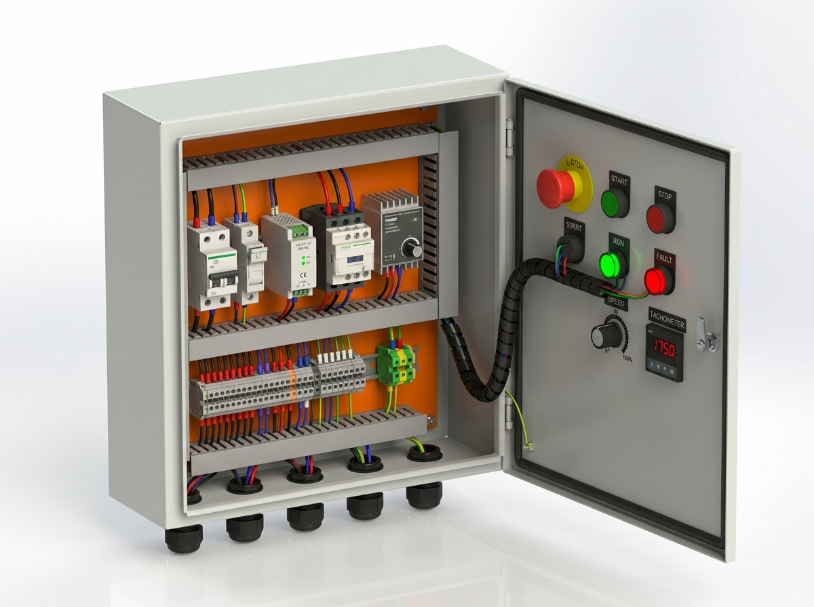
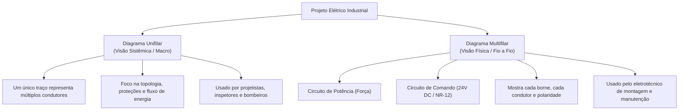
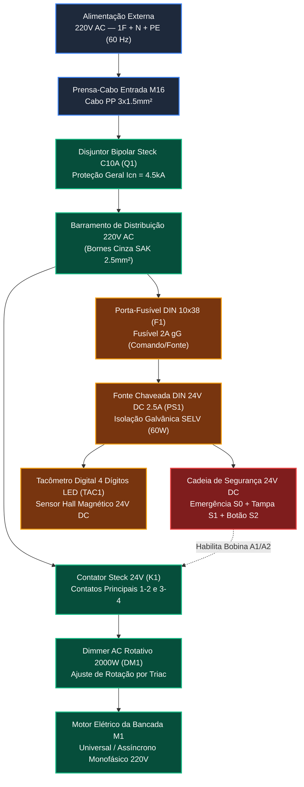
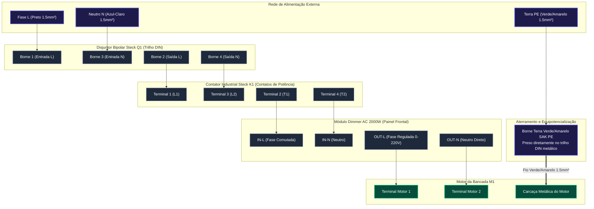
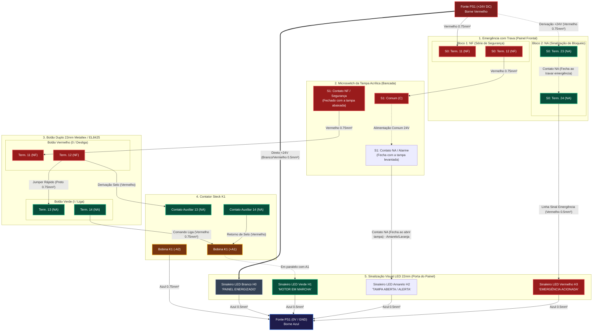
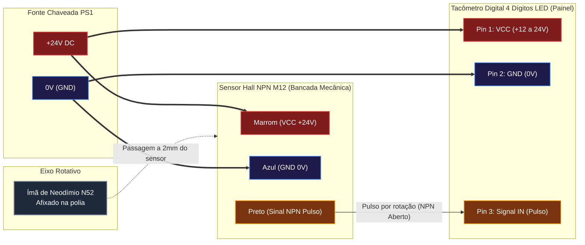

# Projeto Elétrico Industrial: Diagramas Unifilar e Multifilar
## Bancada Metrológica de Testes M1 — Sistema Lean Tech

---

## 1. O que são Diagramas Unifilar e Multifilar?

Na engenharia elétrica industrial (normas **ABNT NBR 5410**, **NR-10**, **NR-12** e **IEC 60617**), existem formas distintas de representar uma instalação elétrica dependendo do objetivo: visão sistêmica macro ou execução física fio a fio.

### 1.1 Diagrama Unifilar
- **Conceito:** Representa todos os condutores de um circuito (fase, neutro, terra, retorno) simplificados em **uma única linha**. Sobre essa linha, traços inclinados normalizados indicam quantos e quais fios passam naquele trecho:
  - Traço longo vertical: Condutor de **Fase** ($L$).
  - Traço em "L" invertido: Condutor de **Neutro** ($N$).
  - Traço em "T": Condutor de **Proteção / Terra** ($PE$).
- **Finalidade:** Permite enxergar num relance a rota da energia: entrada da rede $\rightarrow$ disjuntor geral $\rightarrow$ barramentos $\rightarrow$ ramais de potência e comando.

### 1.2 Diagrama Multifilar
- **Conceito:** Representa **cada condutor físico individualmente com sua rota real**, identificando número de borne, terminais de componentes (ex: `A1`, `A2`, `13`, `14`), bitola em $mm^2$ e cor da fiação.
- **Divisão Padrão:**
  1. **Circuito de Potência (Força):** Linhas de alimentação que transportam a corrente pesada do motor (220V AC).
  2. **Circuito de Comando (Controle e Segurança):** Circuito em extra-baixa tensão de segurança (24V DC) que opera a lógica de liga/desliga, emergência e intertravamento de segurança.

---

## 2. Diagrama Unifilar da Bancada M1

Abaixo está o diagrama unifilar que sintetiza a distribuição geral de energia no painel elétrico:

---

## 3. Diagrama Multifilar de Potência (Circuito de Força — 220V AC)

Este diagrama detalha a rota física dos condutores de potência que alimentam o contator, dimmer e motor elétrico:

---

## 4. Diagrama Multifilar de Comando e Segurança (24V DC / NR-12)

O circuito de comando opera em **tensão contínua de segurança (24V DC)**, isolado galvanicamente da rede 220V através da fonte chaveada. Se qualquer dispositivo de segurança abrir (botão de emergência acionado ou tampa acrílica aberta), a bobina do contator desenergiza instantaneamente por gravidade mecânica.

---

## 5. Circuito do Tacômetro Digital & Sensor Hall

O tacômetro mede com precisão milimétrica a rotação instantânea do eixo motor através da passagem do ímã de neodímio em frente ao sensor Hall:

---

## 6. Tabela De-Para Definitiva da Fiação (Wiring Schedule)

Esta tabela é o guia prático de bancada para o eletrotécnico crimpar e conectar cada condutor:

| ID Cabo | Origem (De)                           | Destino (Para)                        | Função                             |       Bitola       | Cor Normatizada |  Terminal Recomendado   |
| :-----: | :------------------------------------ | :------------------------------------ | :--------------------------------- | :----------------: | :-------------: | :---------------------: |
| **W01** | Prensa-cabo entrada L                 | Disjuntor Q1: Borne 1                 | Fase 220V Geral                    | $1.5\text{ mm}^2$  |      Preto      |  Ilhós Tubular 1.5mm²   |
| **W02** | Prensa-cabo entrada N                 | Disjuntor Q1: Borne 3                 | Neutro 220V Geral                  | $1.5\text{ mm}^2$  |   Azul-claro    |  Ilhós Tubular 1.5mm²   |
| **W03** | Prensa-cabo entrada PE                | Borne de Aterramento DIN (PE)         | Terra Geral da Rede                | $1.5\text{ mm}^2$  |  Verde/Amarelo  |  Olhal ou Ilhós 1.5mm²  |
| **W04** | Disjuntor Q1: Borne 2                 | Contator K1: Borne 1 (L1)             | Fase Potência Comutada             | $1.5\text{ mm}^2$  |      Preto      |  Ilhós Tubular 1.5mm²   |
| **W05** | Disjuntor Q1: Borne 4                 | Contator K1: Borne 3 (L2)             | Neutro Potência Comutado           | $1.5\text{ mm}^2$  |   Azul-claro    |  Ilhós Tubular 1.5mm²   |
| **W06** | Disjuntor Q1: Borne 2                 | Porta-Fusível F1: Entrada             | Alimentação da Fonte 24V           | $0.75\text{ mm}^2$ |      Preto      |  Ilhós Tubular 0.75mm²  |
| **W07** | Disjuntor Q1: Borne 4                 | Fonte PS1: Terminal N                 | Neutro da Fonte 24V                | $0.75\text{ mm}^2$ |   Azul-claro    |  Ilhós Tubular 0.75mm²  |
| **W08** | Porta-Fusível F1: Saída               | Fonte PS1: Terminal L                 | Fase Protegida por Fusível 2A      | $0.75\text{ mm}^2$ |      Preto      |  Ilhós Tubular 0.75mm²  |
| **W09** | Contator K1: Borne 2 (T1)             | Módulo Dimmer: Terminal IN-L          | Fase Potência para Regulador       | $1.5\text{ mm}^2$  |      Preto      |  Ilhós Tubular 1.5mm²   |
| **W10** | Contator K1: Borne 4 (T2)             | Módulo Dimmer: Terminal IN-N          | Neutro para Regulador              | $1.5\text{ mm}^2$  |   Azul-claro    |  Ilhós Tubular 1.5mm²   |
| **W11** | Dimmer: Terminal OUT-L                | Prensa-cabo Motor: Pino 1             | Fase Regulada Motor (0-220V)       | $1.5\text{ mm}^2$  |      Preto      |  Ilhós Tubular 1.5mm²   |
| **W12** | Dimmer: Terminal OUT-N                | Prensa-cabo Motor: Pino 2             | Retorno Neutro Motor               | $1.5\text{ mm}^2$  |   Azul-claro    |  Ilhós Tubular 1.5mm²   |
| **W13** | Borne Terra DIN (PE)                  | Prensa-cabo Motor: Carcaça            | Aterramento de Carcaça Motor       | $1.5\text{ mm}^2$  |  Verde/Amarelo  |  Ilhós Tubular 1.5mm²   |
| **W14** | Fonte PS1: Borne (+V)                 | Botão Emergência S0: Term. 11         | Alimentação da Cadeia de Segurança | $0.75\text{ mm}^2$ |    Vermelho     |  Ilhós Tubular 0.75mm²  |
| **W15** | Botão Emergência S0: Term. 12         | Microswitch Tampa S1: Comum (C)       | Continuidade de Segurança          | $0.75\text{ mm}^2$ |    Vermelho     | Terminal Faston / Ilhós |
| **W16** | Microswitch Tampa S1: Term. NF        | Botão Duplo S2: Term. 11 (NF Desliga) | Linha Segura para Painel           | $0.75\text{ mm}^2$ |    Vermelho     | Terminal Ilhós 0.75mm²  |
| **W17** | Botão Duplo S2: Term. 12 (NF Desliga) | Botão Duplo S2: Term. 13 (NA Liga)    | Jumper de Retenção no Bloco        | $0.75\text{ mm}^2$ |      Preto      |  Ilhós Duplo 2x0.75mm²  |
| **W18** | Botão Duplo S2: Term. 12 (NF Desliga) | Contator K1: Borne 13 (NA Selo)       | Linha de Alimentação do Selo       | $0.75\text{ mm}^2$ |    Vermelho     |  Ilhós Tubular 0.75mm²  |
| **W19** | Botão Duplo S2: Term. 14 (NA Liga)    | Contator K1: Borne A1 (+ Bobina)      | Comando de Pulso Liga              | $0.75\text{ mm}^2$ |    Vermelho     |  Ilhós Tubular 0.75mm²  |
| **W20** | Contator K1: Borne 14 (NA Selo)       | Contator K1: Borne A1 (+ Bobina)      | Retorno do Selo de Retenção        | $0.75\text{ mm}^2$ |    Vermelho     |  Ilhós Duplo 2x0.75mm²  |
| **W21** | Contator K1: Borne A2 (- Bobina)      | Fonte PS1: Borne (-V / GND)           | Retorno 0V DC da Bobina            | $0.75\text{ mm}^2$ |   Azul-escuro   |  Ilhós Tubular 0.75mm²  |
| **W22** | Contator K1: Borne A1                 | Sinaleiro LED Verde H1 (+)            | Alimentação Sinaleiro "Motor ON"   | $0.5\text{ mm}^2$  |    Vermelho     |  Ilhós Tubular 0.5mm²   |
| **W23** | Sinaleiro LED Verde H1 (-)            | Fonte PS1: Borne (-V / GND)           | Retorno 0V Sinaleiro Verde         | $0.5\text{ mm}^2$  |   Azul-escuro   |  Ilhós Tubular 0.5mm²   |
| **W24** | Microswitch Tampa S1: Term. NA        | Sinaleiro LED Amarelo H2 (+)          | Alimentação "Tampa Aberta" (Alerta)| $0.5\text{ mm}^2$  | Amarelo / Laranja|  Ilhós Tubular 0.5mm²   |
| **W25** | Sinaleiro LED Amarelo H2 (-)          | Fonte PS1: Borne (-V / GND)           | Retorno 0V Sinaleiro Amarelo       | $0.5\text{ mm}^2$  |   Azul-escuro   |  Ilhós Tubular 0.5mm²   |
| **W26** | Fonte PS1: Borne (+V)                 | Tacômetro TAC1: Pin 1 (VCC)           | Alimentação 24V do Display         | $0.5\text{ mm}^2$  |    Vermelho     |  Ilhós Tubular 0.5mm²   |
| **W27** | Fonte PS1: Borne (-V / GND)           | Tacômetro TAC1: Pin 2 (GND)           | Terra 0V do Display                | $0.5\text{ mm}^2$  |   Azul-escuro   |  Ilhós Tubular 0.5mm²   |
| **W28** | Fonte PS1: Borne (+V)                 | Sensor Hall: Fio Marrom (+VCC)        | Alimentação 24V do Sensor Hall     | $0.5\text{ mm}^2$  |     Marrom      |  Ilhós Tubular 0.5mm²   |
| **W29** | Fonte PS1: Borne (-V / GND)           | Sensor Hall: Fio Azul (GND)           | Terra 0V do Sensor Hall            | $0.5\text{ mm}^2$  |   Azul-escuro   |  Ilhós Tubular 0.5mm²   |
| **W30** | Sensor Hall: Fio Preto (Sinal NPN)    | Tacômetro TAC1: Pin 3 (Signal)        | Pulso Digital por Rotação          | $0.5\text{ mm}^2$  |      Preto      |  Ilhós Tubular 0.5mm²   |
| **W31** | Fonte PS1: Borne (+V)                 | Botão Emergência S0: Term. 23 (NA)    | Alimentação Bloco Auxiliar Emerg.  | $0.75\text{ mm}^2$ |    Vermelho     |  Ilhós Tubular 0.75mm²  |
| **W32** | Botão Emergência S0: Term. 24 (NA)    | Sinaleiro LED Vermelho H3 (+)         | Alimentação "Emergência Acionada"  | $0.5\text{ mm}^2$  |    Vermelho     |  Ilhós Tubular 0.5mm²   |
| **W33** | Sinaleiro LED Vermelho H3 (-)         | Fonte PS1: Borne (-V / GND)           | Retorno 0V Sinaleiro Vermelho      | $0.5\text{ mm}^2$  |   Azul-escuro   |  Ilhós Tubular 0.5mm²   |
| **W34** | Fonte PS1: Borne (+V)                 | Sinaleiro LED Branco H0 (+)           | Alimentação "Painel Energizado"    | $0.5\text{ mm}^2$  |Branco / Vermelho|  Ilhós Tubular 0.5mm²   |
| **W35** | Sinaleiro LED Branco H0 (-)           | Fonte PS1: Borne (-V / GND)           | Retorno 0V Sinaleiro Branco        | $0.5\text{ mm}^2$  |   Azul-escuro   |  Ilhós Tubular 0.5mm²   |

---

## 7. Recomendações Críticas de Montagem e Segurança (NR-10 & NR-12)

> [!IMPORTANT]
> 1. **Separação Galvânica e Fiação em Canaletas:**
>    - Nunca passe cabos de potência 220V AC junto com os cabos de sinal do sensor Hall ou de comunicação da sonda IoT na mesma canaleta ranhurada. Mantenha canaletas separadas para evitar indução eletromagnética e ruído de leitura no tacômetro.
>
> 2. **Espaguete Espiral na Porta do Painel:**
>    - Toda a fiação flexível que vai da placa de montagem para a tampa frontal articulada (botão de emergência, botão duplo, dimmer e tacômetro) deve ser protegida por espaguete espiral plástico para evitar desgaste por abrasão mecânica nas dobradiças.
>
> 3. **Aterramento Equipotencial da Placa Metálica e da Porta:**
>    - A placa de montagem de fundo e a porta de chapa de aço devem ser aterradas ao borne PE através de uma cordoalha de cobre flexível de $2.5\text{ mm}^2$.
>
> 4. **Ação Positiva de Segurança:**
>    - Se a tampa de acrílico for levantada durante a operação do motor, o contato NF do microswitch se abre instantaneamente, derrubando a retenção da bobina do contator em menos de $15\text{ ms}$. Mesmo se a tampa for fechada novamente, o motor **NÃO** religa sozinho (exige um novo aperto deliberado no botão verde de Liga), cumprindo a exigência de proteção contra partida intempestiva da NR-12.
